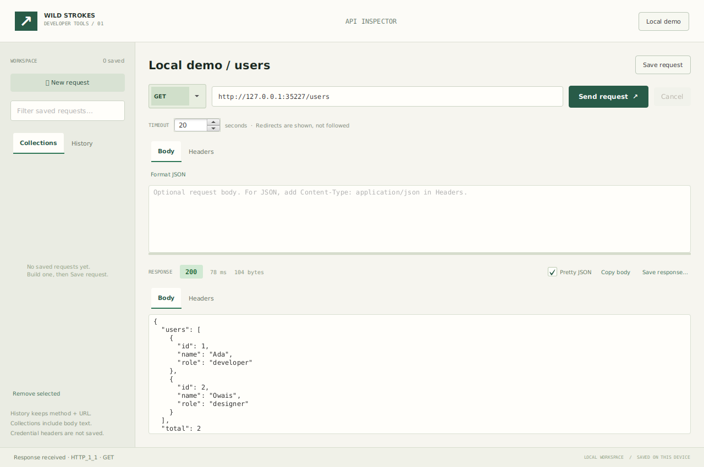

# API Inspector

A Java desktop workspace for sending HTTP requests, inspecting responses and keeping reusable request collections. Built with JavaFX and the JDK HTTP client.



## Run

Install **JDK 17 or newer** and **Maven 3.8+**, then run from this folder:

```sh
mvn javafx:run
```

Maven downloads the JavaFX libraries for your operating system. A desktop display and an internet connection for the initial dependency download are required. This is a desktop application; GitHub Pages does not run Java apps.

Click **Local demo** to start an embedded loopback HTTP server and send a real request to `/users`. Change the path to `/health` or send a POST to `/echo` with a JSON body and `Content-Type: application/json`. The demo server stops when the app exits.

## Features

- GET, POST, PUT, PATCH, DELETE, HEAD and OPTIONS requests.
- URL, raw headers and request body editors; strict JSON formatting.
- Asynchronous requests with cancellation and a 1–120 second deadline.
- HTTP status, response headers, elapsed time and original byte count.
- Pretty JSON, copy response text, and save the original response bytes.
- Named local collections, searchable history and persistent storage.
- Keyboard shortcuts: Ctrl/Cmd+Enter to send; Ctrl/Cmd+S to save a request.
- Embedded demo endpoints for errors, redirects, slow responses and binary data.

## Local data and limits

The workspace lives at `~/.wildstrokes/api-inspector/workspace.json`. Collections retain request bodies in plain text. Credential-like headers are omitted and credential-like query values are redacted when saving; review bodies before saving secrets. History records only the method, redacted URL, status, timestamp and timing. The app keeps up to 200 saved requests and 100 history entries. A damaged workspace is left unchanged and a temporary workspace is used for that session.

HTTP and HTTPS URLs are supported. Redirects are shown as responses rather than automatically followed. Request bodies are limited to 1 MiB, saved body text to 128 KiB and response bodies to 2 MiB. Binary responses can be exported without text conversion. This version has no cookie jar, OAuth flow, multipart editor, streaming viewer or collections import/export.

## Verify

```sh
mvn test
```

The `CoreChecks` executable runs during Maven's test phase and fails the build on an assertion failure. It covers request validation, strict JSON parsing, persistent collections, redaction, history bounds, and real loopback HTTP requests including timeout, cancellation, redirects, binary data and response limits. No external API or credentials are needed.

See [validation notes](docs/VALIDATION.md) for the checks performed on this version.

## Code map

| Class | Responsibility |
| --- | --- |
| `InspectorApp` | JavaFX interface and request lifecycle |
| `HttpEngine` | Async HTTP, bounded response subscriber and deadlines |
| `RequestSpec` | Immutable request input and validation |
| `WorkspaceStore` | Atomic JSON persistence and secret redaction |
| `JsonTools` | Strict JSON formatting |
| `DemoServer` | Embedded loopback HTTP fixtures |
| `CoreChecks` | Executable integration and persistence checks |

References: [OpenJFX setup](https://openjfx.io/openjfx-docs/) · [JDK HTTP client](https://docs.oracle.com/en/java/javase/17/docs/api/java.net.http/java/net/http/HttpClient.html)

MIT licensed. Created for the Wild Strokes developer portfolio.
