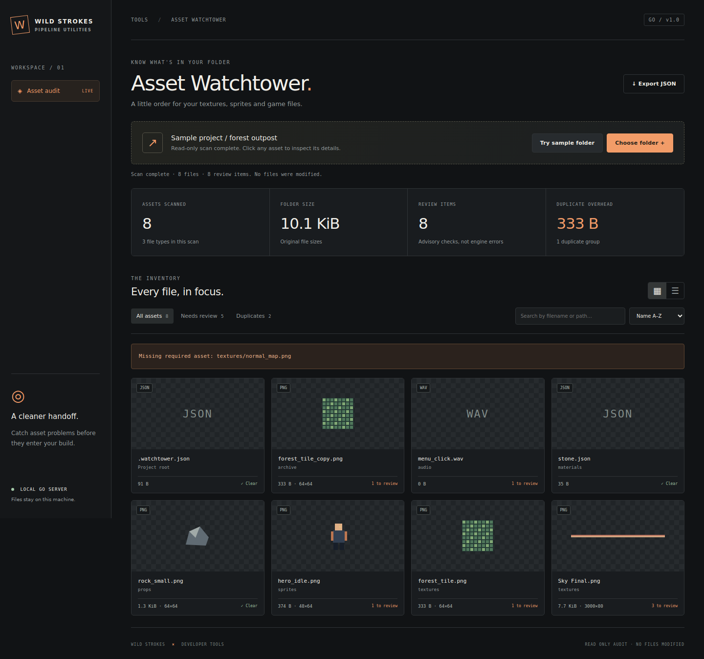

# Asset Watchtower

**A local asset audit for game artists and developers.** Scan a folder, inspect its textures, find exact duplicate files and export a report before handing assets to a developer.

Built in Go with a small browser interface. No third-party Go modules, JavaScript framework, account, API key or cloud service.



## Start

Install **Go 1.24 or newer**, open this folder in a terminal and run:

```sh
go run .
```

Open **http://127.0.0.1:8787**. Click **Try sample folder** for a working demonstration, or **Choose folder** to audit your own assets. The sample generates PNGs in the browser and sends them through the same Go scanner as real files.

```sh
# Build an executable for your current operating system
go build -o watchtower .

# Choose a different local port
go run . -port 9090

# Headless mode: JSON to stdout, no web server
go run . -scan ./examples/sample-project > report.json
```

On Windows the executable can be named `watchtower.exe`. Keep the exported report outside the directory being scanned. The server embeds its HTML, CSS and JavaScript, so a built executable needs no adjacent web folder.

## What it checks

| Check | Result |
| --- | --- |
| SHA-256 file hashes | Exact duplicate groups and potential redundant bytes |
| PNG, JPEG and GIF headers | Dimensions and textures over 2048 px |
| Image pixels | Safe PNG previews up to 192 px; first GIF frame only |
| Dimensions | Advisory for non-power-of-two textures |
| File sizes | Empty files and files over the 5 MiB review budget |
| Basenames | Advisory for names outside lowercase letters, numbers, underscores and hyphens |
| Optional manifest | Required paths absent from the selected folder |

The dashboard includes path search, all/review/duplicate filters, sorting, grid/list layouts, per-file details, scan cancellation and JSON export. Large result sets display 48 cards at a time. Exported browser reports omit embedded preview images.

These are review suggestions, not engine validation failures. Duplicate files may serve a deliberate purpose; the app never deletes or rewrites assets. It does not measure GPU compression, visually similar images, mesh topology, engine imports or unused assets.

## Missing-file manifest

Put `.watchtower.json` at the root of the chosen asset folder:

```json
{
  "required": [
    "textures/forest_tile.png",
    "sprites/hero_idle.png",
    "audio/menu_click.wav"
  ]
}
```

Paths are relative to that folder and matched exactly, including case. Missing paths appear above the inventory and in the exported report. This explicit manifest is engine-neutral; the scanner does not infer dependencies from Godot, Unity, Blender or glTF files. Invalid manifest paths and malformed JSON produce review notes.

## Boundaries

- 1,000 files, 12 MiB per file, 64 MiB of original bytes per scan. Select a smaller subfolder for larger projects.
- Four analysis workers; one active HTTP scan at a time.
- Images above 16 megapixels retain metadata but skip pixel decoding and preview generation.
- Other file types receive byte, hash and naming checks with a file-type placeholder.
- `.git`, `node_modules` and `.godot` folders are excluded. CLI scans skip symlinks and special files and use a rooted filesystem handle.
- Browser folder selection works best in Chromium-based browsers. No native folder picker dependency is needed.
- HTTP uploads are processed in memory on the local server; nothing is persisted by the app. CLI reports and downloaded exports are the files you choose to save. The server binds only to `127.0.0.1`, validates browser origins and accepts loopback Host values.
- Go runs the scanner. **GitHub Pages cannot host the Go backend.** Clone/download the source and run it locally.

## Test

```sh
go test -race -cover ./...
go vet ./...
```

Tests exercise actual multipart uploads and a real HTTP listener, duplicate accounting, PNG thumbnail decoding, missing manifests, deterministic output, invalid paths, truncated/oversized uploads, origin/Host guards, cancellation and CLI filesystem traversal. See [validation notes](docs/VALIDATION.md).

## Layout

```text
main.go                 Local HTTP server, embedded UI and folder CLI
main_test.go            HTTP and filesystem integration tests
internal/audit/          Bounded analysis workers and audit tests
web/                    Browser dashboard; no build step
examples/sample-project Minimal manifest/duplicate fixture
```

MIT licensed · Wild Strokes
