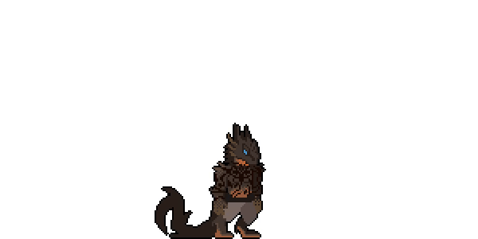

# Beast Shift

A small animation inspection desk built around a pixel character transformation.
Presented by **Wild Strokes**.



[Open the live viewer](https://strokeswild08.github.io/beast-shift/)

## What it does

- Plays the original sequence at 10 FPS, with 0.25× to 2× speed controls.
- Steps through all 102 source frames without approximate video seeking.
- Loops a selected frame range, including a single pose.
- Zooms up to 3× with nearest-neighbor rendering and an optional inspection grid.
- Includes a scrubber, clickable thumbnail strip, and the original WebM.
- Adapts to phones and respects the reduced-motion preference on first load.

The original is 600 × 300 pixels and 10.2 seconds long. The white background is part of the supplied clip; this project preserves it. The sequence contains a transformation, not separate controllable game actions.

## Run it

Open `index.html` in a modern browser. No installation, build step, or external services are required. If your browser restricts local assets, run a static server from this folder:

```sh
python3 -m http.server 8000
```

Then visit `http://localhost:8000`.

## Animation event editor

Add named **sound**, **impact**, and **screen shake** markers at any frame. Use **Use current frame** to copy the playhead position. Markers can be edited, removed, or selected from the event lane to jump to their frame. Overlapping cues remain individually accessible in the list.

Markers save locally in this browser when storage is available. Export JSON for a portable backup; importing a valid file replaces the current list. Invalid files leave current markers intact. Imports are limited to 250 KB and 500 events.

Preview tones are optional synthesized placeholders, enabled by a user gesture. Supply the actual sounds in your game and map them to the exported event names. Screen shake is a viewer effect and respects reduced-motion preferences. Paused stepping and scrubbing do not fire cues. Each crossed frame fires during playback, including when fast playback advances several frames or a loop wraps. Starting or resuming playback fires cues on the current frame again.

### JSON contract

```json
{
  "version": 1,
  "clip": "beast-shift",
  "fps": 10,
  "totalFrames": 102,
  "frameBase": 1,
  "events": [
    { "frame": 51, "type": "screen_shake", "name": "Shift shake", "timeSeconds": 5 }
  ]
}
```

Frames are **one-based** in the UI and exported JSON. Frame 1 occurs at 0 seconds; frame 102 at 10.1 seconds. Each source frame lasts 0.1 seconds, so the clip lasts 10.2 seconds. Exported timestamps always follow the source's 10 FPS timing, regardless of preview speed. Import recalculates timestamps from frames rather than trusting supplied `timeSeconds` values. The included sample cues are suggested timings that you can adjust.

`events-core.js` contains reusable validation, import/export, and frame lookup functions. `event-editor.js` manages the UI, local persistence, and optional previews. To use the cues in an engine, convert the current source frame to the same frame base, find its events, and dispatch each type to your audio or camera system.

## Verify

With Node.js installed, run:

```sh
node tests/events.test.cjs
```

The checks cover schema validation, JSON round trips, timestamps, fast playback, loop boundaries, silent scrubbing, and the last frame. They simulate playback timing; they do not replace visual checks in a browser.

## Controls

| Control | Action |
| --- | --- |
| Space | Play / pause |
| Left / right arrow | Previous / next frame |
| R | Reset all viewer settings |
| Timeline | Jump to a frame and pause |
| First / last frame | Set an inclusive loop range (1–102) |

Keyboard shortcuts apply when focus is outside an interactive control. Standard button and form keyboard controls still work normally.

Zoom enlarges the full source frame; use the preview scrollbars to inspect different areas. The inspection grid is a viewer overlay, not a transparent-background preview. Turn off **Loop selection** to play through the complete remaining sequence once.

## Publish with GitHub Pages

1. Create a repository named `beast-shift-animation-viewer`.
2. Upload this folder's **contents**, so `index.html` is at the repository root.
3. In **Settings → Pages**, choose **Deploy from a branch**.
4. Select `main` and `/ (root)`, then save.
5. GitHub will show the resulting website URL when publication completes.

The included `.nojekyll` file allows the project to be served as static files.

## Files

```text
index.html            Page structure and controls
styles.css            Responsive visual design
app.js                Atlas renderer, timeline, and playback state
events-core.js        Portable event validation and JSON contract
event-editor.js       Marker editing, persistence, and previews
tests/events.test.cjs  Event data and playback checks
assets/frames.png     10-column atlas of the original decoded frames
assets/original.webm  Original supplied animation
assets/preview.gif    README animation preview
assets/poster.png     Still frame for presentation
```

The atlas uses 600 × 300 cells with ten columns. Only the first 102 cells are used. Playback uses a single requestAnimationFrame loop with elapsed-time accumulation; stepping and scrubbing address integer source frames. No dependencies or network fonts are used.

## Asset rights

The animation was supplied for this showcase. No third-party reuse license is granted by this repository. Confirm the animation's ownership and any client permissions before publishing it publicly. No general-purpose code license has been added; the repository owner can choose one separately.
