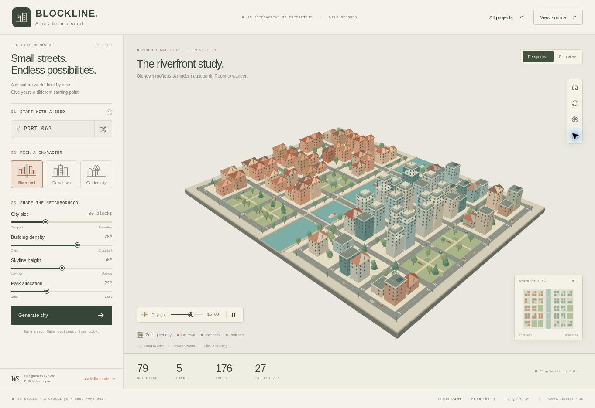

# Blockline

**A city from a seed.** A browser-based 3D city generator with two riverbanks, connected streets, three crossings, district-specific buildings and a waterfront you can explore.

[Open the city workshop](https://strokeswild08.github.io/blockline/) · [Generation core](src/generator.js) · [Tests](tests/generator.test.js) · [Architecture](docs/ARCHITECTURE.md)



## Explore

- Start from **Riverfront**, **Downtown** or **Garden city**, or enter your own seed.
- Set city size, building density, skyline height and park allocation, then generate.
- Drag to orbit, scroll to zoom, or use two fingers on a touchscreen. Switch to plan view for an overhead look.
- Click a building to inspect its height, floor count, footprint and intended use. Press **H** with the viewport focused to reset the camera.
- Move the daylight slider from morning to night. Pause cars and boats, rotate the view, inspect wireframes or color the building districts.
- Save a PNG, export the complete city as JSON, import a saved plan, or copy a link to the same seed and generation settings.
- Open **Inside the code** to read the actual generation module and inspect a sample parcel from the current city.

[Sample city recipe](docs/sample-city.json) is ready to import through the workshop.

The visual direction is an architectural miniature: terracotta roofs on the west bank, stepped east-bank towers, muted parkland and a blue-green river. All city geometry is built in code. No model downloads, image textures, API keys, analytics or remote CDNs are required.

## Run locally

From this directory:

```sh
python3 -m http.server 8080
```

Open `http://localhost:8080`. Use an HTTP server rather than opening `index.html` as a `file:` URL because the source uses ES modules.

Run the data and traffic tests with **Node.js 20 or later**:

```sh
npm test
```

There is no dependency installation or build step. A pinned copy of **Three.js r170** and its matching OrbitControls are included in `vendor/` with their MIT license. Application code is also MIT licensed; see [LICENSE](LICENSE).

## Code map

| File | Responsibility |
| --- | --- |
| `src/random.js` | Stable string hashing and independent seeded random streams |
| `src/generator.js` | Bounded configuration, street graph, zoning, setbacks, parcel population, JSON recipes and statistics |
| `src/traffic.js` | Seeded ambient cars that stay on connected graph edges |
| `src/scene.js` | Three.js scene, instanced details, roof geometry, picking, cameras, lighting and resource disposal |
| `src/canvas-renderer.js` | CPU polygon projection when WebGL cannot be initialized; consumes the same scene |
| `src/app.js` | Controls, dirty settings, minimap, accessible inspector, URL state, import/export and source panel |
| `tests/generator.test.js` | Determinism, bounds, overlap, connectivity, serialization, input validation and traffic invariants |

## How generation works

The output is a plain JavaScript object, separate from the scene graph. The same normalized configuration reproduces the same streets, parcels, colors and trees. Independent random streams are named for streets, zoning, each block, the waterfront and traffic. Changing the lighting or orbiting the camera cannot change the plan.

The street graph is connected within and across both banks. Every road edge has two valid endpoints; only the three designated bridges cross the river. Building footprints occupy subdivided blocks with fixed street setbacks and spacing between neighbors. A guaranteed civic park gives each plan an open square.

```js
import { generateCity } from './src/generator.js';

const city = generateCity({
  seed: 'PORT-062',
  size: 5,
  density: 78,
  height: 58,
  greenery: 24,
});

console.log(city.roads.nodes, city.buildings, city.stats);
```

## Boundaries

This is a procedural world-building and rendering experiment. The layout uses varied rectangular blocks around a fixed river, rather than GIS data or an urban-growth simulation. Park allocation is a per-block probability, so the measured result can differ from its control value. Density controls occupied parcel slots; it is not a population estimate.

Cars are ambient visual agents. They follow graph edges with lane offsets, choose turns at intersections and use designated bridges. They do not model traffic lights, collision avoidance, queues or accurate turning curves. Decorative boats shuttle within river sections, leaving the low bridges clear.

JSON import accepts versioned, bounded settings and regenerates the plan. It does not execute imported code or trust imported building geometry. Share links contain generation settings, not camera or daylight state.

The primary renderer uses WebGL, instancing, materials and shadow maps. Browsers without WebGL use a flat polygon compatibility renderer at up to 10 redraws per second. The fallback omits shadow maps and advanced materials; its painter's ordering can differ where geometry intersects. See [validation notes](docs/VALIDATION.md) for the checks performed and the remaining visual verification limit.

---

Built for the [Wild Strokes project collection](https://strokeswild08.github.io/projects/).
