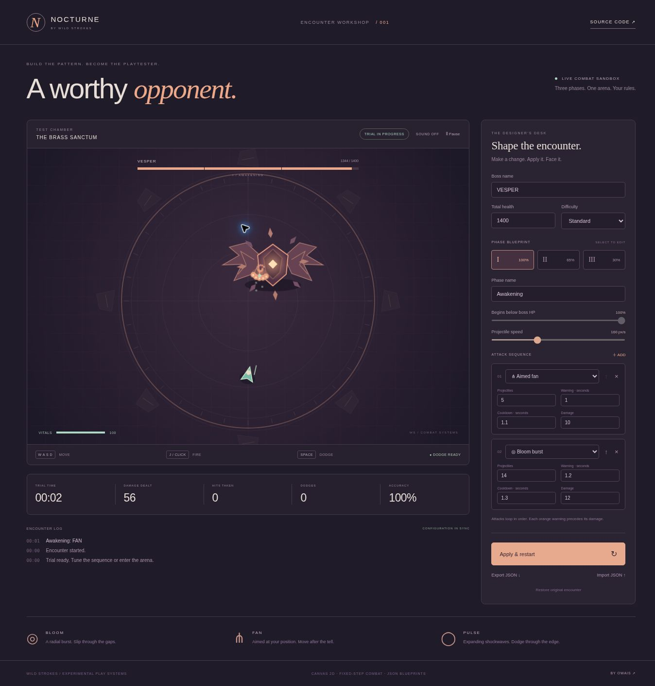

# Nocturne — Boss Encounter Workshop

**Build the pattern. Become the playtester.** A playable three-phase boss fight designer by **Owais / Wild Strokes**.

**[Play the live workshop](https://strokeswild08.github.io/boss-forge/)**

The Brass Oracle is a procedural 2D boss in an inlaid circular arena. Tune its attacks in the side panel, apply your blueprint, and test it with real movement, aiming, damage and dodge invulnerability. Everything runs in the browser with no dependencies, account or server.



## Design an encounter

- Three editable phases, each with a name, health threshold, projectile speed and ordered attack sequence.
- **Bloom:** radial projectiles with dodgeable gaps.
- **Fan:** a cone aimed at your position when its warning begins.
- **Pulse:** expanding shockwaves with up to three staggered rings.
- Set projectile/ring count, warning duration, cooldown and damage per attack.
- Add, remove and reorder attacks (1–6 per phase).
- Change boss health and difficulty, then **Apply & restart** to test. Draft edits do not silently change an active encounter.
- Inspect trial time, damage, hits taken, dodges and shot accuracy.
- Export/import validated JSON blueprints; the last applied blueprint is saved in browser storage.
- Optional synthesized sound, pause/resume, focus-loss pause, touch controls and reduced-motion support.

## Controls

| Action | Desktop | Touch |
| --- | --- | --- |
| Move | WASD or arrow keys | Left joystick |
| Fire at boss | Hold J | Hold FIRE |
| Aim and fire | Hold left mouse button over arena | Tap/hold arena |
| Dodge | Space (1.05-second cooldown) | DODGE |
| Pause / resume | P or toolbar button | Toolbar button |

The mint character is the player. Peach/pink projectiles belong to the boss. Dodge gives 0.26 seconds of invulnerability; normal damage gives 0.75 seconds. Crossing a phase threshold clears hazards and provides a short grace period before the new sequence. Difficulty changes player health and boss projectile speed/damage.

## Run locally

```sh
cd boss-forge
python3 -m http.server 8080
```

Open `http://localhost:8080`. Serve over HTTP so ES modules load; do not open `index.html` as a local file.

## Test

Requires Node.js 20+; no `npm install` is needed.

```sh
npm test
```

Tests cover configuration validation, phase boundaries, normalized movement, arena bounds, telegraphs, all attack patterns, dodge timing, damage invulnerability, pause behavior, full-fight victory, defeat/reset, difficulty and long-run state bounds.

## Implementation

| File | Responsibility |
| --- | --- |
| `src/engine.js` | DOM-free encounter state, configuration validation, attack timing and collisions |
| `src/render.js` | Procedural Canvas 2D arena, boss, player, warning indicators and effects |
| `src/app.js` | Editor, input, audio, blueprint persistence/import/export, HUD and fixed-step loop |
| `tests/engine.test.js` | Offline simulation tests using Node's built-in runner |

Simulation runs at 120 Hz with a bounded catch-up budget. Projectiles, particles and event history are capped. Rendering uses Canvas 2D, not WebGL, with no external image, audio or font downloads. All artwork is drawn procedurally in code. This is a focused single-boss combat/editor prototype, not a full game or a general-purpose game engine. No multiplayer, server persistence or executable scripting in imported blueprints is included.
