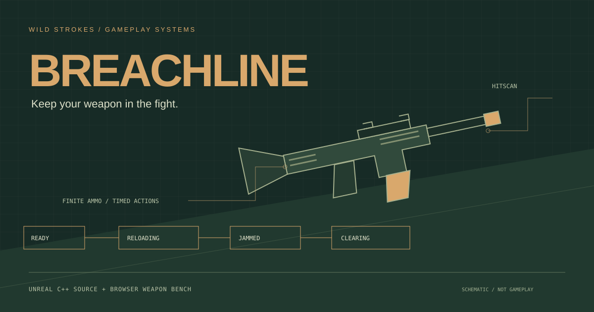
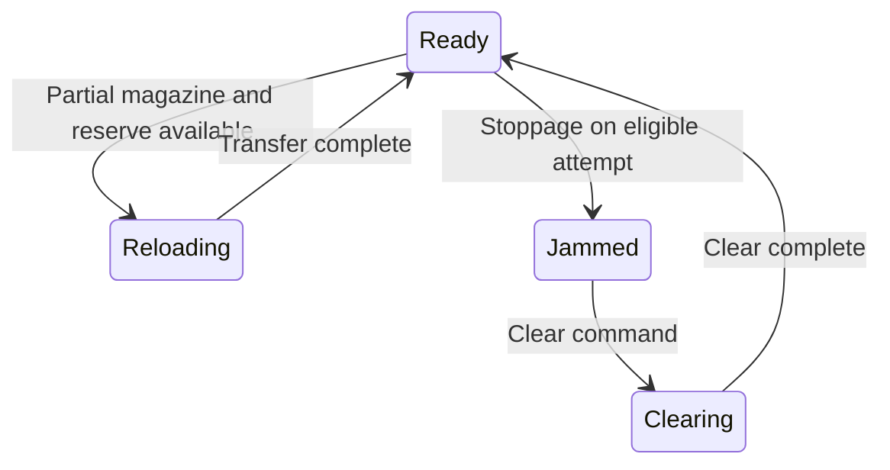

# Breachline

**A small weapon mechanics prototype by Wild Strokes.**

[Try the browser weapon bench](https://strokeswild08.github.io/breachline/) · [Weapon core](Source/Breachline/Public/WeaponCore.h) · [Validation notes](docs/VALIDATION.md)



The interesting part of a weapon system is what happens when it cannot fire. Breachline keeps that logic in one place: a magazine and finite reserve, a rate limit, timed reloads, and a stoppage that must be cleared before firing resumes.

This folder contains two things:

- **Unreal C++ source project**, targeting **UE 5.5**: first-person movement, hold-to-fire, focus/zoom, camera recoil, hitscan damage, resetting targets, an on-screen diagnostic HUD and a runtime-built shooting range.
- **Playable 2D browser companion**: a fixed-camera target drill with the same weapon rules, touch input, visual recoil, optional synthesized sound and action telemetry. It is a JavaScript companion, **not an Unreal build or export**.

**Validation boundary:** the portable C++ core compiles and passes its native tests. The Unreal headers, reflection, build targets, editor gameplay and packaging still need validation in an installed UE 5.5 toolchain. No executable Unreal release or Unreal gameplay video is included. See [exact test scope](docs/VALIDATION.md).

## Try it first

Open the [browser bench](https://strokeswild08.github.io/breachline/), enter the range, and click a numbered target. Reload after a few shots. Introduce a practice jam and try to fire; clear it, then continue.

| Action | Browser | Unreal source |
| --- | --- | --- |
| Aim | Cursor / touch position | Mouse look |
| Fire | Click/touch and hold; Space; trigger button | Left mouse and hold |
| Reload | R / button | R |
| Clear stoppage | F / button | F |
| Introduce practice jam | J / button | J |
| Reset range and ammo | T / button | T |
| Move | Fixed camera | WASD |
| Focus / zoom | Not included | Right mouse and hold |

Mobile: tap a target directly, then use the on-screen controls. Sound starts off and is synthesized locally; there are no audio downloads.

Serve the browser companion locally from this folder:

```sh
python3 -m http.server 8080
```

Open `http://localhost:8080`. JavaScript modules need an HTTP server; opening the HTML with a `file:` URL is not supported.

## Open the Unreal project

1. Install Unreal Engine **5.5** and its supported C++ toolchain. On Windows, install Visual Studio 2022 with Game development with C++ and the Windows SDK.
2. Download this repository and copy the entire `breachline` folder to your workspace. Keep `Config/`, `Source/` and `Breachline.uproject` together.
3. Generate project files from `Breachline.uproject` using the Unreal shell integration. Build the **BreachlineEditor / Development Editor** target for your platform.
4. Open `Breachline.uproject`. The configured startup map is the engine's Entry map; the configured game mode creates the floor, walls, target stands and lighting at runtime.
5. Press Play in Selected Viewport. Click the viewport to capture input. Shift+F1 releases the mouse in the editor.

The range uses engine basic shapes and a blockout receiver. There are no third-party art packs, skeletal reload animations, purchased guns or generated binary Blueprint assets. The HUD and timed state changes provide reload/clear feedback; those are not hand animations.

The source deliberately uses the standard `PlayerInput` / `InputComponent` mapping system to avoid binary Input Action assets. `Config/DefaultInput.ini` selects those classes explicitly.

### Reuse the weapon component

Copy `WeaponCore.h`, `BreachWeaponComponent.h` and `BreachWeaponComponent.cpp` into your own module. Change the `BREACHLINE_API` export macro to your module's macro. Add the component to an actor. Bind `OnFired` to your own trace/projectile, effects and animation; bind `OnStateChanged` to UI.

`TryFire()` returns true only when a round was spent and `OnFired` was emitted. Do not apply damage on a blocked attempt. Call `Reload()` and `ClearJam()` from your input. `JamChance` is read when the component starts or `ResetWeapon()` is called. The fixed capacity/timers can be changed in `Breachline::Settings` and passed into the core inside the component.

No replication is implemented. For multiplayer, an authority-owned simulation, validated commands, replicated state and presentation reconciliation would be separate work.

## Rules and tuning

| Setting | Default |
| --- | --- |
| Magazine / starting reserve | 12 / 60 rounds |
| Minimum shot interval | 0.15 seconds (400 rounds/minute maximum) |
| Reload | 1.8 seconds |
| Clear stoppage | 1.0 second |
| Random stoppage chance | 6% per eligible trigger attempt |
| Native trace length | 12,000 cm |
| Target return | 2 seconds after a hit |

A jam is modeled as a failure to discharge: it consumes no ammunition. Reloading transfers rounds from reserve rather than discarding the old magazine. A jam blocks reload; clearing blocks fire. Repeated reload/clear commands cannot restart their timers. Reset explicitly restores the entire drill. These are prototype rules, not a claim to simulate a real weapon.

The core uses injected time and random values. It does not read the engine clock or generate randomness, which keeps edge cases reproducible. The Unreal component supplies frame time and an `FRandomStream`. The browser supplies frame time and `Math.random`.



Cooldown and empty-magazine checks also gate shots in Ready. Large time steps finish the current action but do not synthesize missed shots or auto-repeat reloads.

## Run the checks

Requirements: `g++` with C++17 support, Node.js **22+**, and a POSIX shell.

```sh
./tests/run.sh
```

This compiles the exact core included by the Unreal component with warnings as errors, AddressSanitizer and UndefinedBehaviorSanitizer. It runs **17 tests**, including **100,000 seeded invariant checks**, then compares C++ and browser states after **20,016 commands**.

Some restricted containers cannot run LeakSanitizer's process inspection. In that environment only, use `ASAN_OPTIONS=detect_leaks=0 ./tests/run.sh`. Address and undefined-behavior checks remain enabled. This is the local development environment's setting; GitHub CI uses the normal command.

Browser checks are optional locally and included in GitHub Actions:

```sh
npm install --no-save --package-lock=false playwright@1.62.1
npx playwright install chromium
node tests/browser.cjs
```

They exercise desktop and mobile input, firing, hit detection, reload blocking, random and manual jams, clearing, finite ammunition, keyboard reset, layout overflow and screenshots. See the [Breachline verification workflow](https://github.com/strokeswild08/strokeswild08.github.io/actions/workflows/breachline.yml) for the actual run result and screenshot artifacts. This workflow **does not compile Unreal**.

## File map

| Path | Responsibility |
| --- | --- |
| `Source/Breachline/Public/WeaponCore.h` | Engine-independent state, ammunition and timing |
| `Source/Breachline/*/BreachWeaponComponent.*` | Tick/random adapter and Blueprint event surface |
| `Source/Breachline/*/BreachCharacter.*` | Input, camera, traces and counters |
| `Source/Breachline/*/RangeTarget.*` | Hit registration and timed target reset |
| `Source/Breachline/*/RangeGameMode.*` | Procedural range geometry |
| `Source/Breachline/*/RangeHUD.*` | Diagnostic UI and crosshair |
| `demo/weapon-core.mjs` | Browser state-machine counterpart |
| `demo/app.mjs` | Canvas range, controls, sound and telemetry |
| `tests/` | Native regression tests, parity harness and browser checks |

## Scope

Single-player programming sample; hitscan rather than ballistics. No networking, enemies, inventory persistence, real-world weapon tuning or finished gun art. The browser range is a 2D interaction study. Unreal runtime integration remains unverified until an editor build and playtest are completed.

Source, browser graphics and synthesized sound code: [MIT](LICENSE). Unreal Engine and its bundled assets remain subject to Epic's own license and are not redistributed in this repository.

**Owais / Wild Strokes** · [Portfolio](https://strokeswild08.github.io/) · [More projects](https://strokeswild08.github.io/projects/)
