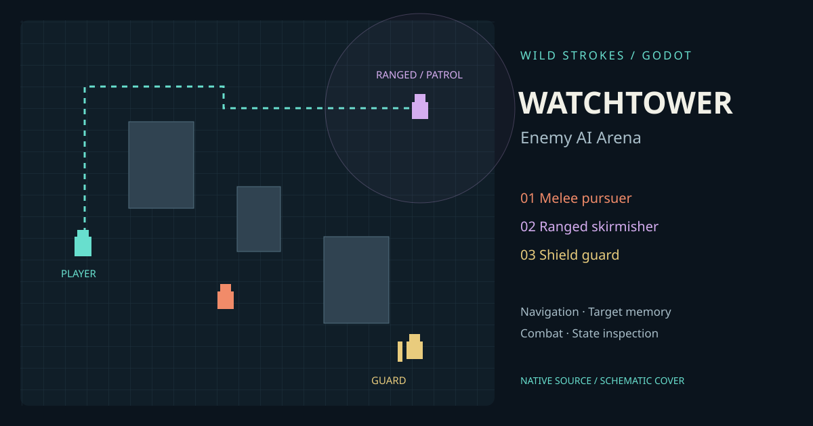

# Watchtower — Godot Enemy AI Arena

A native top-down combat sandbox by **Owais / Wild Strokes**. Three enemy archetypes share navigation and target memory, with distinct attack and retreat behavior. Toggle debug rendering to inspect state labels, routes and detection radii.

[Project page](https://strokeswild08.github.io/godot-ai-arena/) · [Download source](https://strokeswild08.github.io/godot-ai-arena/watchtower-source.zip)



## Run

1. Download and extract `watchtower-source.zip`.
2. Import `project.godot` in **Godot 4.4.1 standard edition**.
3. Press F5. No .NET, plugins, external images or account needed.

This is a native Godot project. The project page is a description and source download, not a browser game export.

| Controls | Action |
| --- | --- |
| WASD | Move |
| Mouse | Aim |
| Left mouse button | Fire |
| Tab | Toggle AI debug |
| Space | Pause/resume simulation |
| R | Reset |
| Sidebar buttons | Spawn enemies, debug, pause and reset |

## AI behavior

| Archetype | Behavior |
| --- | --- |
| Melee / coral | Closes distance, telegraphs a short windup, then strikes if the target remains nearby |
| Ranged / lilac | Shoots from medium distance, retreats when the player approaches |
| Guard / gold | Slower pursuer with more health; frontal shield reduces received damage by 75%, flanking bypasses it |

Enemies detect within 275 pixels with wall occlusion. Detection is omnidirectional, not a directional vision cone. Losing sight stores the last seen position for 2.4 seconds; the enemy searches there, then resumes its four-point patrol. Visible targets trigger chase or attack depending on range. Health below 25% triggers retreat while the player is visible. Low-health agents resume patrol/search when the target is lost.

Attack rings telegraph a 0.3-second windup. Melee hits require the target to remain within range. Ranged shots are straight projectiles that collide with walls and characters. The player has 70 health, melee strikes deal 12 damage and ranged shots deal 10. Player shots deal 19 before shield reduction.

Navigation uses `AStarGrid2D`, refreshed every 0.25 seconds per agent, with orthogonal paths to prevent corner cutting. `CharacterBody2D` resolves wall collisions. A local separation force reduces overlap; agents do not physically collide with one another. Retreat chooses a reachable nearby cell farther from the target. Spawn buttons use five designated points and reject occupied or player-adjacent positions, so a request can do nothing until space opens. There is a 24-agent cap.

## Structure and adaptation

- `scripts/arena.gd`: grid/world construction, line-of-sight sampling, path service, spawns, projectile simulation, sidebar and debug rendering.
- `scripts/agent.gd`: player input, enemy state decisions, target memory, locomotion, attacks, directional shield and character rendering.
- `main.tscn`: root scene.
- `tests/test_arena.gd`: native engine integration checks.

To change the layout, edit `build_world()`; the same cells drive geometry and navigation. Update patrol and spawn points to match. For a larger game, extract an arena/navigation service, turn procedural agents into reusable scenes and move archetype settings into Resources. Replace `_draw()` art with your own sprite animations while preserving collision sizes. State changes are immediate range-based decisions; this small example does not provide a behavior-tree framework.

## Verification

Godot **4.4.1** headless editor import passed. **31 integration checks passed**, including routes around pillars, wall occlusion, frontal versus flanking shield damage, chase/attack/search/patrol transitions, ranged retreat, projectile creation, pause, death/reset and a 240-tick encounter.

```sh
godot --headless --path godot-ai-arena --editor --import --quit
godot --headless --path godot-ai-arena --script tests/test_arena.gd
```

For an extracted standalone source ZIP, use `--path .` instead. Graphical mouse interaction, visual layout, exported builds and performance on user hardware have not been verified. Cover art is a schematic, not captured gameplay. FPS in the sidebar is a live engine statistic, not a performance guarantee.

## Scope

Single-player sandbox with original procedural starter visuals. No multiplayer, gamepad support, persistence, sprite animation, sound, difficulty waves or executable export is included. Navigation is intended for this small rectangular grid; projectile lifetime and agent counts are bounded. This is not a large-scale battle simulator.

## License

Original code and procedural visuals are MIT licensed. Godot is separately licensed by its contributors. See `LICENSE`.
