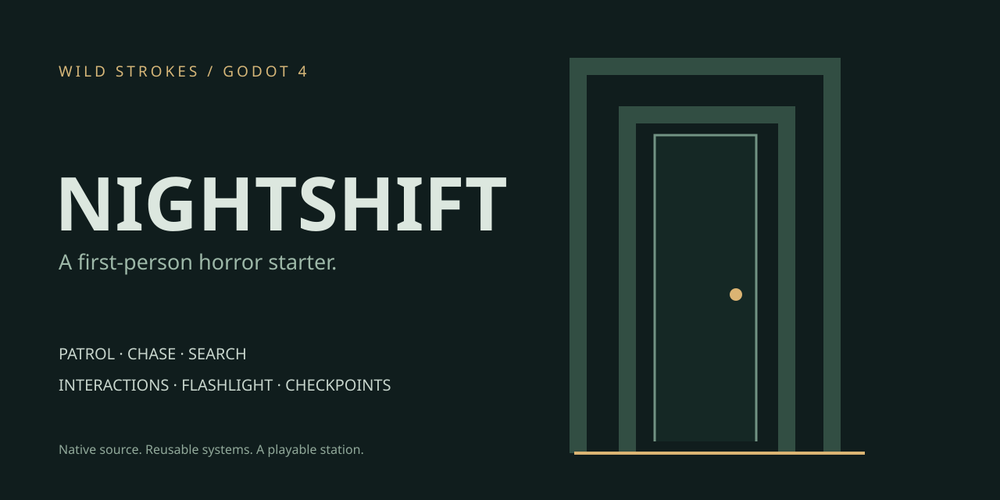

# Nightshift — Godot Horror Kit

A native first-person horror starter by **Owais / Wild Strokes**. Find the brass key in a closed station, avoid the caretaker and unlock the exit. The playable example connects reusable gameplay systems without third-party assets or addons.

**[Project page](https://strokeswild08.github.io/godot-horror-kit/)** · **[Source](https://github.com/strokeswild08/strokeswild08.github.io/tree/main/godot-horror-kit)** · **[Discuss a paid project](mailto:strokeswild08@gmail.com)**



## What this demonstrates

- **First-person controller:** collision-aware movement, smooth acceleration, sprint stamina, mouse look and optional head bob.
- **Interaction interface:** a camera raycast finds an Area3D with `prompt()` and `interact()` methods. Includes notes, pickups, a battery and a locked exit.
- **Enemy state machine:** patrol, chase, search and return to patrol. Walls occlude vision; nearby sprinting can attract the caretaker through walls.
- **Grid pathfinding:** AStarGrid2D uses the same layout as the physical world. Ordered waypoints keep the enemy from cutting corridor corners.
- **Flashlight:** finite battery, gradual recovery while switched off, spare battery pickup and shadowed spotlight.
- **Checkpoints:** versioned JSON, validation, temporary-file writes, automatic checkpoint on key pickup and manual save/load.
- **Interface:** title screen, objectives, interaction prompt, stamina/battery meters, settings, pause, notes and retry/completion screens.
- **Audio:** original synthesized footsteps, pickup, switch, door and detection cues.

## Run the project

1. Install **Godot 4.4.1** (standard edition, no .NET required).
2. Download this repository and open `godot-horror-kit/project.godot` with Godot's Import button.
3. Press **F6** with `main.tscn` open, or **F5** to run the project.
4. Choose **Start a new shift**.

This is a desktop keyboard-and-mouse project. The GitHub Pages page introduces the project; it is not a browser game export.

| Input | Action |
| --- | --- |
| WASD | Move |
| Mouse | Look |
| Shift | Sprint; drains stamina and makes noise |
| E | Interact with the item under the crosshair |
| F | Toggle flashlight |
| Escape | Pause / close note / resume |
| F5 in the running game | Save checkpoint |
| F9 in the running game | Load checkpoint |

Aim at the brass key on the archive desk and press E. The archive is in the south-west; the exit is in the north-east. Walking avoids the hearing trigger, but does not make you invisible. Use walls to break sight.

## Structure

```text
project.godot           Engine settings and main-scene entry point
main.tscn              Root scene
scripts/
  game.gd             World construction and session orchestration
  player.gd           First-person movement and interaction raycast
  enemy.gd            Patrol/chase/search AI and path following
  interactable.gd     Notes, key, battery and exit behavior
  level.gd            Shared layout, navigation and safe checkpoint positions
  save_store.gd       Save schema, validation and file persistence
  hud.gd              Menus and gameplay interface
  sound.gd            Procedural sound cues
 tests/test_kit.gd     Headless integration checks
 docs/                Cover and integration guide
```

## Reuse in your own game

Read **[the integration guide](docs/INTEGRATION.md)** for script responsibilities, collision layers, custom interactions, enemy tuning and the save schema. The example world is generated from the layout in `level.gd`; change that layout to experiment without manually rebuilding navigation.

The scripts currently receive a `game` reference for their shared interface. They are reusable starting points, not a drop-in addon for arbitrary scenes. For a larger project, replace that reference with signals/services, build reusable scenes and substitute your own models/animations.

## Verification

Tested with **Godot 4.4.1** using headless import and integration checks. A graphical playthrough and exported builds have not been verified in this environment. Run:

```sh
godot --headless --path godot-horror-kit --editor --import --quit
godot --headless --path godot-horror-kit --script tests/test_kit.gd
```

The tests check reachable objectives/patrols, malformed saves, save round-trip, key pickup and restoration, note pause, occluded/unoccluded enemy vision, state transitions and retry/win flow. They preserve an existing checkpoint after the test run.

## Scope and design choices

- Single-player native **Godot** project. There is no UE5 version, multiplayer, combat, external backend or network service in this release.
- Environment and caretaker use procedural placeholder geometry. Replace the visuals while keeping the underlying systems.
- The grid route planner matches this station layout; an arbitrary 3D terrain needs navigation meshes or a different navigation adapter.
- Checkpoints save location, yaw, key/exit state, flashlight and battery. They snap to a safe location in the current tile. Enemy patrol and stamina reset on load; spare battery usage and elapsed time are session-only.
- Settings apply to the current session. No controller/mobile support or persistence of settings yet.
- Flashlight-off regeneration keeps this small demo recoverable instead of leaving a player permanently in darkness.

## Work with Wild Strokes

Available for paid game systems, UI, pixel art, environment assets and sound design, with clear milestones and progress updates.

**Email:** strokeswild08@gmail.com · **Discord:** `wildstrokes23`

Original project code and procedural assets are released under the [MIT License](LICENSE). Godot itself is separately licensed by its contributors.
