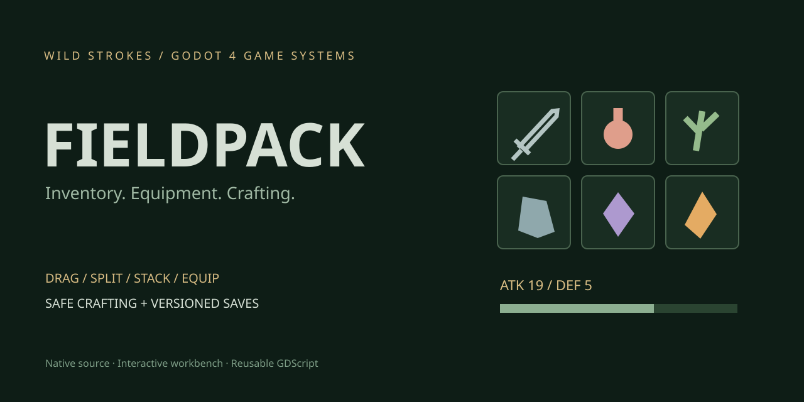

# Fieldpack — Godot Inventory & Equipment Kit

A native **Godot 4** inventory sandbox by **Owais / Wild Strokes**. Move items between a backpack and chest, split stacks, equip gear, brew potions, forge a stronger sword and compare its damage on a training dummy.

**[Project & download](https://strokeswild08.github.io/godot-inventory-kit/)** · **[Source](https://github.com/strokeswild08/strokeswild08.github.io/tree/main/godot-inventory-kit)**



## Included systems

| System | Behavior |
| --- | --- |
| Backpack / chest | 24 backpack slots and 12 chest slots; stack limits, merges, transfers and sorting |
| Drag-and-drop | Move, merge, swap and Shift-drag to split; incompatible equipment swaps are rejected |
| Equipment | Weapon, armor and charm slots; attack and defense derive from equipped items |
| Consumables | Potions restore health; a full-health attempt keeps the potion |
| Crafting | Three recipes; costs and output are applied atomically so full inventory cannot eat materials |
| Save/load | Versioned JSON; validates IDs, capacities, gear types, whole quantities and health before replacement |
| Training sandbox | Strike a dummy, take a hit and compare damage before/after equipping items |
| Interface | Item inspection, tooltips, slot selection, activity log, reset confirmation and explicit failure messages |

## Open and try it

1. Download the source ZIP from the project page and extract it.
2. In **Godot 4.4.1**, choose **Import**, select `project.godot`, then **Import & Edit**.
3. Press **F5** in the editor to run the project.
4. Double-click the iron sword to equip it. Strike the dummy and watch the damage.
5. Forge an ember blade, equip it, reset the dummy and compare the stronger hit.

No plugins, .NET runtime, external assets or network services are required. Tested with Godot 4.4.1; other versions are not certified. This is a native desktop project, not a browser export.

| Input | Action |
| --- | --- |
| Click slot | Inspect item |
| Drag item | Move, swap or merge |
| Shift + drag | Move half of a stack, rounded up |
| Double-click gear | Equip; double-click equipped gear to return it to backpack |
| Double-click potion | Heal |
| Transfer button | Move complete stack to chest/backpack; gear goes to backpack |
| Sort button | Combine and reorder backpack stacks |
| F5 in running game | Save loadout |
| F9 in running game | Load loadout |

Crafting uses backpack materials only. Move materials from the chest before crafting. Gather buttons simulate world pickups and always report if inventory is full.

## Architecture

```text
scripts/catalog.gd     Stable item IDs, gear categories and recipes
scripts/inventory.gd   UI-independent rules and transactions
scripts/slot.gd        Native Control drag/drop, selection and tooltips
scripts/glyph.gd       Original code-drawn item symbols
scripts/workbench.gd   Interactive demo UI and training actions
scripts/save_store.gd  Checkpoint file persistence
```

`Inventory` extends `RefCounted` and emits `changed` and `message(text)` signals. The interface listens to those signals; it does not implement crafting or storage rules itself. Reuse the model with your own HUD, character or loot pickup script.

Read **[INTEGRATION.md](docs/INTEGRATION.md)** for API examples and adapting this kit to an RPG, survival or action game.

## Validation

Headless engine import and **37 model/UI integration checks** passed on Godot 4.4.1. Checks include stack conservation, equipment restrictions, crafting failure rollback, full-container behavior, save round-trip, malformed saves, UI gear activation, training stats and drag/drop handlers.

```sh
godot --headless --path godot-inventory-kit --editor --import --quit
godot --headless --path godot-inventory-kit --script tests/test_inventory.gd
```

The test preserves any prior save file. Graphical mouse gestures, visual layout and exported executables have not been verified in this environment.

## Scope

- A reusable **Godot starter**, with an interactive UI workbench; no 3D exploration/combat level.
- Single-player, local inventory. No multiplayer replication, persistence backend or UE5 implementation.
- Fixed demo capacities and three gear slots. Expand the model and save migration if your game needs dynamic bags, weight, durability or multiple characters.
- Saves include items, gear and health. Dummy health, selected slot and activity log are session-only.
- Model arrays are public for integration convenience. Gameplay code should mutate them through the API; directly changing arrays bypasses validation and signals.
- UI uses original procedural symbols. Replace `glyph.gd` with your own textures and theme without changing item IDs.

## Wild Strokes

Available for paid game systems, game UI, pixel art and sound design. Clear milestones and progress updates.

[Explore the Wild Strokes projects](https://strokeswild08.github.io/projects/)

Original source and procedural assets are released under the [MIT License](LICENSE).
