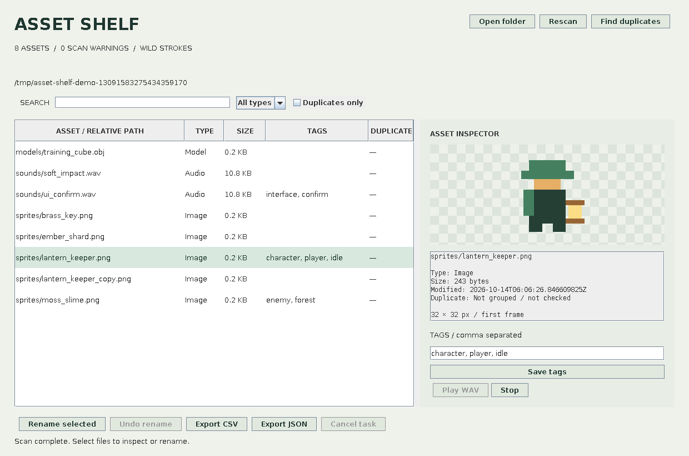

# Asset Shelf — Java Game Asset Organizer

A local desktop tool by **Owais / Wild Strokes** for browsing game-art folders, adding tags, finding duplicate files and planning reversible batch renames. Written in **Java 17 + Swing**, with no third-party dependencies.

**[Project page](https://strokeswild08.github.io/java-asset-shelf/)** · **[Runnable JAR](https://strokeswild08.github.io/java-asset-shelf/AssetShelf.jar)** · **[Source ZIP](https://strokeswild08.github.io/java-asset-shelf/asset-shelf-source.zip)**



The image above is an offscreen rendering of the actual Swing panel with original generated sample assets, not a mockup. Desktop window interaction and audio-device playback have not been exercised in this environment.

## Run

Install a Java **17 or newer runtime**, download `AssetShelf.jar`, then run:

```sh
java -jar AssetShelf.jar
```

For a disposable sample pack with pixel sprites, WAV files and a cube OBJ:

```sh
java -jar AssetShelf.jar --demo
```

The demo creates a new temporary folder each time. It is safe to practice renaming these generated samples; the application does not automatically delete the sample folder. `run.bat` is included in the source for Windows command-line launching after building. This is a desktop app, not a browser app or standalone native installer.

## Everyday workflow

1. **Open folder:** scan supported assets recursively. Search by relative path, type or tags, and filter Image / Audio / Model.
2. **Inspect:** select an asset for an image preview or metadata. PNG/JPEG/GIF/BMP use built-in decoders; GIF shows the first frame. WAV has Play/Stop controls.
3. **Tag:** enter comma-separated tags and Save tags. Metadata lives in `asset-shelf-tags.properties` in the selected root; original asset bytes stay unchanged.
4. **Find duplicates:** compare SHA-256 hashes for same-size candidates. Duplicates receive group labels; nothing is deleted automatically.
5. **Rename selected:** select rows, enter a prefix, review the full source → destination list and confirm. Example: `dungeon_001.png`. Files stay in their original directories and retain extensions.
6. **Undo rename:** restore the latest successful batch in this session after verifying file content and destination availability.
7. **Export CSV/JSON:** save the currently visible filtered rows, tags and duplicate groups. Existing export files are rejected; choose a new filename.

## File support

| Category | Indexed extensions | Preview |
| --- | --- | --- |
| Image/art | PNG, JPG/JPEG, GIF, BMP, WebP, TGA, PSD, Aseprite/ASE | Built-in image decoding when available; otherwise metadata |
| Audio | WAV, MP3, OGG, FLAC, AIFF | Metadata; WAV playback through Java Sound if its codec/device is supported |
| Model | GLB, GLTF, FBX, OBJ, BLEND | Metadata, not 3D rendering |

Preview files are capped at 32 MB and 25 million pixels; large accepted images are decoded with subsampling. WAV playback is capped at 20 MB. The scan stops at 10,000 supported assets, skips hidden subdirectories and directories named `node_modules`, `build` and `target`, and does not follow file/directory symlinks. Inaccessible paths appear in scan warnings; rescan after correcting access. PNG animation and GIF animation playback are not included.

## Rename behavior

- Preview creation does not rename files.
- Targets must be absent, including conservative case-insensitive filename conflicts.
- Prefixes allow 1–40 ASCII letters/digits/hyphens/underscores; path separators are rejected.
- Source hashes are checked again before a batch is applied. Undo refuses files whose content changed.
- Failed sequential moves trigger rollback of completed moves. If rollback itself fails, the error lists paths needing manual recovery.
- Undo is **one batch, in memory**. Switching folders or closing the app loses it. There is no persistent crash-recovery journal, rename-cycle support or cross-process locking.
- Renaming does not update references inside Godot projects, Unreal assets or other files. Use this tool for loose asset libraries and account for external references.
- Tags follow successful renames/undo. If a metadata save fails after file moves, the app reports that separately.

These checks prevent ordinary collisions and stale-file edits; they do not make an entire batch atomic against crashes or concurrent external filesystem changes. Mutating tasks cannot be cancelled mid-operation. The window waits for active tasks before closing.

## Build from source

A **JDK 17+** is needed to compile; a Java runtime is enough for the delivered JAR.

```sh
bash build.sh
java -jar AssetShelf.jar --demo
bash test.sh
```

On Windows, run `build.bat` from a terminal with `javac`, `jar` and `java` on PATH. No Maven/Gradle, database, account, network request or cloud upload is required.

## Source structure

- `Catalog.java`: supported-file scan, streamed SHA-256 and duplicate grouping.
- `TagStore.java`: relative-path properties, tag validation and metadata writes.
- `RenameService.java`: deterministic plans, collision/content checks, rollback and undo.
- `Exports.java`: CSV formula-prefix handling, JSON escaping and no-overwrite exports.
- `App.java`: Swing interface, background workers, previews and WAV controls.
- `SamplePack.java`: original demo sprite/audio/model generation.
- `tests/shelf/CoreTest.java`: real filesystem integration cases.
- `tests/shelf/UiSmoke.java`: actual Swing panel data/filter/preview checks and offscreen capture.

## Verification

Compiled with Java 17, `--release 17 -Xlint:all -Werror`. **35 filesystem integration checks passed**, including duplicate content, persistent tags, preview non-mutation, rename/undo, case collisions, stale source/undo refusal, injected move failure rollback, symlink/outside-root rejection and export no-overwrite. Export output was also parsed as JSON independently.

Headless Swing checks passed for loading eight demo assets, tag filtering, image decoding and actual panel rendering. This does not verify native desktop event interaction, file-chooser dialogs, audio hardware or every OS. Windows/macOS execution has not been tested. The GitHub workflow builds the runnable JAR and runs filesystem + headless Swing checks on Linux.

Original code and generated sample assets are MIT licensed. Java itself is separately licensed by its distributor.
