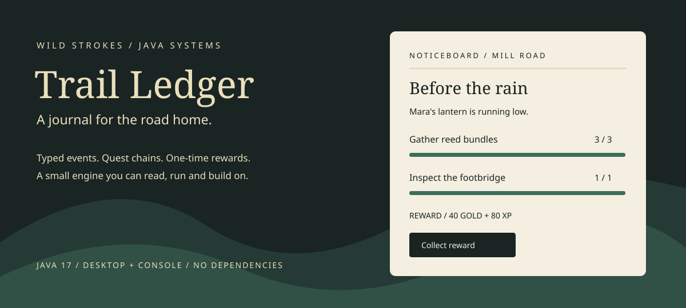

# Trail Ledger



A small Java quest engine with a desktop noticeboard and a console demo. Four jobs follow a courier route through a mill, a footbridge and a ridge beacon. The useful part is the journal underneath: typed gameplay events, prerequisite chains, one-time rewards and validated save files.

**By Wild Strokes / Owais.** Java 17 or newer. No external libraries, build tool or network connection needed at runtime.

## Run it

Install a **JDK**, not a runtime-only Java installation. From this folder:

| Platform | Console | Desktop noticeboard |
| --- | --- | --- |
| Linux / macOS | `bash run.sh` | `bash run.sh --gui` |
| Windows Command Prompt | `run.bat` | `run.bat --gui` |

The desktop demo needs a graphical session. It uses Swing; it is not a browser game. On Windows, run the batch file from Command Prompt to keep error messages visible.

The launch scripts compile the sources into `build/`, then start the demo. They invoke the JDK compiler module through `java`; the equivalent standard build is:

```sh
mkdir -p build
javac --release 17 -d build src/strokes/quests/*.java
java -cp build strokes.quests.Main --gui
```

## Try the first job

In the desktop noticeboard, select **Before the rain**, accept it, gather reed three times and visit the bridge. Collect the reward to unlock **A light on the ridge**. The buttons simulate gameplay events; there is no movement or combat scene.

The same route in the console:

```text
accept supplies
event collect reed 3
event visit bridge
list
claim supplies
wallet
save
quit
```

Run the demo again and type `load`. The supplies reward remains claimed and the next job is available. `docs/walkthrough.txt` contains a complete four-job route. An unknown command or invalid action prints an error and leaves the session running.

## What the engine handles

- Four event kinds: collect, defeat, visit and talk. Both the kind and target must match an objective.
- Events update all matching **active** quests. Events before acceptance are ignored; there is no event history replay.
- Counts clamp at the objective's target, including very large event amounts.
- A quest becomes ready when every objective is complete. Prerequisites unlock after rewards are claimed.
- Rewards can be claimed once. Gold and XP are derived from claimed quest IDs rather than a second mutable wallet.
- Catalog checks reject duplicate IDs, missing prerequisites and dependency cycles.
- Saves use a versioned Java Properties file. Loads validate all state before changing the live journal.
- Saving replaces a temporary file in the same directory, with an atomic move when the filesystem supports it.

## Integrate it into a game

Keep a `QuestJournal` in your game state. Send events after gameplay actions succeed, and render `views()` in your UI:

```java
QuestJournal journal = new QuestJournal(Catalog.demo());
journal.accept("wolves");

// Call after an enemy has actually been defeated.
journal.record(new QuestJournal.Event(Quest.Kind.DEFEAT, "wolf", 1));

if (journal.status("wolves") == QuestJournal.Status.READY) {
    Quest.Reward reward = journal.claim("wolves");
    // Use the returned reward to notify your UI. Journal owns its demo wallet.
}
```

Quest definitions are immutable records. Add content in `Catalog.java` or supply your own `List<Quest>` to the journal. Use stable quest/objective IDs and keep the catalog consistent with saved games. Objectives within a job can complete in any order. The engine checks quest prerequisites, not the order of individual objectives.

| File | Responsibility |
| --- | --- |
| `Quest.java` | Quest, objective and reward definitions |
| `QuestJournal.java` | Acceptance, status, progress, claiming and restore validation |
| `JournalStore.java` | Save-file reads and replacement writes |
| `Catalog.java` | Four sample jobs |
| `Main.java` | Console commands and desktop entry point |
| `JournalWindow.java` | Swing noticeboard adapter |
| `test/strokes/quests/JournalTests.java` | Dependency-free regression suite |

## Checks

```sh
bash test.sh
```

Or, on Windows:

```bat
java com.sun.tools.javac.Main --release 17 -d build src\strokes\quests\*.java test\strokes\quests\*.java
java -cp build strokes.quests.JournalTests
```

The tests cover prerequisite chains, matching events, shared targets, count overflow, early/duplicate rewards, save round trips, replacement saves and rejection of inconsistent saves without changing live state. The repository workflow runs this suite on Java 17.

## Scope

This is a single-player engine sample. Call the journal from one thread; the desktop demo uses the Swing event dispatch thread. Event deduplication, quest failure, timed objectives, external content loading and server-authoritative rewards are not included. Repeated events represent repeated gameplay actions.

Saves are local to `saves/journal.properties` and are manually triggered. They validate structure and consistency, not authenticity: a player can edit a valid save. Catalog migrations and tamper protection would need a separate design. The save version is a format version, not a catalog-content hash.

The engine and console route were tested on OpenJDK 17. Graphical interaction has not been verified in the headless development environment. The cover above is an illustration of the project, not a captured screenshot.

## License

MIT for the code and project cover in this folder. See [LICENSE](LICENSE).
