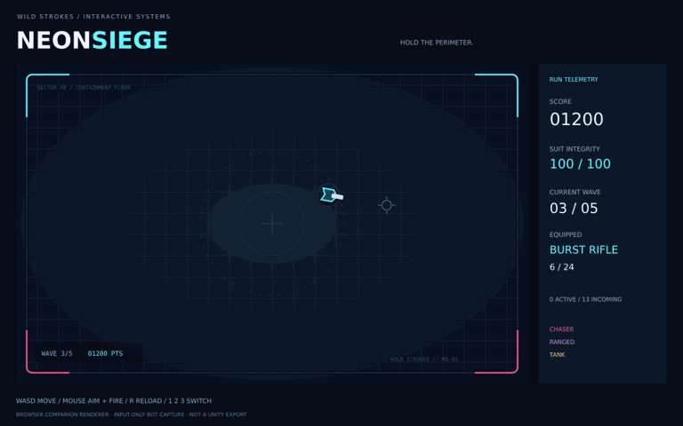

# Neon Siege

**Five waves. Three weapons. Hold the perimeter.**

A top-down survival project by Wild Strokes, with a **Unity 6 / C# implementation** and a **separate browser companion** for quick play.

[Play browser companion](https://strokeswild08.github.io/neon-siege/) · [Download source ZIP](Neon_Siege_Source.zip)



The GIF is an input-only bot run rendered by the browser companion's SVG renderer through Sharp. It is **not** a Unity capture or a browser screenshot. The companion and Unity version share weapon/wave rules by design; they are separate implementations.

## What's included

- WASD movement, mouse aim and held-fire shooting.
- Pistol, five-pellet shotgun and scheduled three-round burst rifle.
- Separate magazines and reload timers; infinite reserve ammo.
- Chasers, ranged attackers and slow armored tanks.
- Five finite waves with increasing spawn budgets.
- One upgrade between waves: damage, movement speed or maximum health; every choice restores health.
- Swept segment projectile collision, enemy damage cooldown, score and restart.
- Reusable pools for projectile and enemy objects.
- Browser extras: pause, touch controls, optional synthesized audio, local personal best and pool diagnostics.
- Runtime Unity arena, geometric units, HUD and editor scene-generation menu.

## Validation status

| Area | Result |
|---|---|
| Actual portable C# rules | **197 assertions passed**, compiled with Roslyn and executed on .NET 8 |
| JavaScript rules / simulation | **4032 assertions passed**, including an input-only bot clearing all five waves |
| Companion renderer | 32 SVG frames rendered through Sharp; representative PNG visually inspected |
| JavaScript syntax | Checked with Node |
| Browser DOM/input/audio/layout | **Not browser-tested** in this environment |
| Unity Editor / Unity build / Unity playtest | **Not run — Unity Editor unavailable** |

The playable link is the browser companion, **not a Unity WebGL export**. Unity source needs editor integration testing before it can be described as a verified Unity build.

## Controls

| Input | Action |
|---|---|
| WASD / browser arrows | Move |
| Mouse | Aim |
| Hold left mouse | Fire |
| 1 / 2 / 3 | Select weapon; choose an upgrade between waves |
| R | Reload |
| Escape | Pause / resume |
| Enter | Start / restart after win or loss |

Unity uses WASD movement; arrow movement is a browser extra. Touch buttons are provided in the companion, but keyboard and mouse are recommended. To aim on touch, tap or drag on the arena; hold FIRE while moving with the directional buttons.

All three weapons have unlimited reserve ammunition. Shotgun pellets spend one shell per trigger. Burst rounds each spend one round, and reloading is blocked until a scheduled burst finishes. Holstered reloads and already-started bursts continue. An active burst uses its originating weapon's damage/spread and the current aim direction. Player damage has a 0.6-second cooldown.

## Open Unity source

1. Install **Unity 6.0**, targeted project version **6000.0.40f1**, with your desired desktop build support.
2. In Unity Hub, add the `Unity/` directory as a project and open it.
3. Let the built-in module manifest resolve. No marketplace art or external assets are needed.
4. Choose **Neon Siege → Create Demo Scene**. Save prompts protect existing scene edits.
5. Press **Play**. A runtime bootstrap constructs the arena, camera, pools and game.
6. To build, use the generated `Assets/Scenes/NeonSiege.unity` scene in Build Profiles.

The source uses built-in rendering and legacy keyboard/mouse input. If input errors appear, set **Project Settings → Player → Active Input Handling** to **Input Manager (Old)** or **Both**, then restart the editor. URP/HDRP projects need compatible replacement materials instead of `Unlit/Color`.

### Unity editor checks still required

- Compile scripts and verify the bootstrap creates exactly one game.
- Check movement/aim alignment, camera coverage, weapon UI and restart.
- Check pooled objects fully reset on reuse and on run restart.
- Verify ranged bullets, nearest-target collision, wave upgrade gating, defeat and victory.
- Verify every weapon's scheduled burst/reload behavior when switching weapons.
- Package and play a desktop build before distributing it as tested.

## Source map

| Path | Responsibility |
|---|---|
| `Unity/Assets/Scripts/SiegeRules.cs` | Engine-independent C# weapons, magazines, burst timing and wave state |
| `Unity/Assets/Scripts/SiegeGame.cs` | Unity input, procedural scene, pools, combat and HUD |
| `Unity/Assets/Editor/SiegeSceneBuilder.cs` | Creates and registers the demo scene |
| `Tests/Program.cs` | Native C# rule assertions against the actual Unity rule file |
| `web/engine.mjs` | Browser rules and deterministic simulation, ported from the C# design |
| `web/render.mjs` | Pure SVG renderer used by the companion and preview captures |
| `web/app.mjs` | Browser input, overlay UI, audio and local best score |
| `Tests/browser-rules.mjs` | Browser model, pooling, projectile and input-only bot checks |

## Run tests

```sh
dotnet run --project Tests/SiegeTests.csproj
node Tests/browser-rules.mjs
node --check web/app.mjs
```

No third-party test packages are needed. The five-wave bot operates through movement/fire/aim/reload/upgrade inputs; it does not alter health, damage or enemy positions. The native C# suite does not reference UnityEngine, and therefore does not validate Unity-specific APIs or rendering.

For local browser play, serve this folder with a static server, for example `python3 -m http.server 8080`, and open `http://localhost:8080`. ES modules require HTTP(S); opening the HTML directly as a local file is not supported.

## Deliberate limits

One open arena; no cover navigation, multiplayer, save slots, campaign, boss, animation assets or music. The two versions use different rendering and spatial coordinate systems, so identical seeds do not guarantee identical gameplay. Browser personal best is stored only on the current device. Simulation steps cap delta time at 50 ms, so long stalls slow the simulation rather than catching up all elapsed real time. Unity has no synthesized audio or touch UI in this source version.

[Unity's object pool reference](https://docs.unity.com/en-us/engine/6000.0/script-reference/unityengine/pool/objectpool1)

MIT licensed source. Unity and its built-in modules remain subject to Unity's terms.
