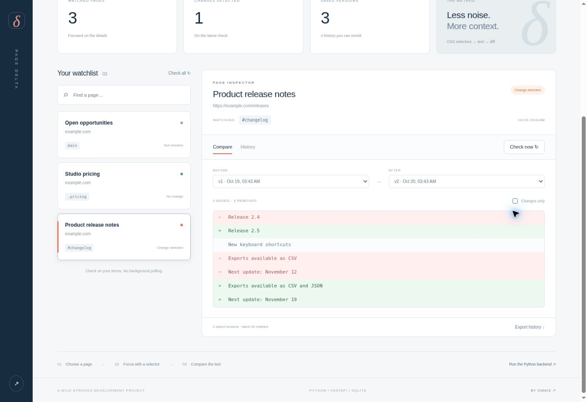

# Page Delta

**Notice the difference.** A public webpage text change tracker by **Owais / Wild Strokes**, built with Python, FastAPI, SQLite and a responsive JavaScript interface.

**[Interactive sample demo](https://strokeswild08.github.io/page-delta/web/)** · Real URL checks run through the Python backend below.



## What it does

- Watch a public HTML page or a specific section using a CSS selector.
- Check manually, save a baseline, and retain up to 30 distinct snapshots per watch.
- Compare any two saved versions with readable added/removed lines.
- Hide unchanged lines, search watches, browse history, and export it as JSON.
- Report failed requests or missing selectors while retaining the last successful content.
- Deduplicate unchanged checks with a SHA-256 content hash.
- Keep up to 50 watches in a local SQLite database, with persistence across restarts.

## Run the real tracker

Requires Python 3.10+.

```sh
cd page-delta
python -m venv .venv
# macOS / Linux
source .venv/bin/activate
# Windows PowerShell: .venv\Scripts\Activate.ps1
pip install -r requirements.txt
uvicorn app.main:app --host 127.0.0.1 --port 8000
```

Open `http://127.0.0.1:8000`. The UI detects the local API and switches to live mode. Add a URL and CSS selector, then click **Check now**. A later check compares against the previous successful version. Interactive API documentation is at `/docs`.

The default database is `data/tracker.sqlite3`. Set `PAGE_DELTA_DB` to choose another path. Keep the data directory if you want to preserve your history.

## GitHub Pages preview

GitHub Pages serves static files and does not run Python. The hosted preview uses clearly labeled sample records, simulates changes when you press Check, and stores demo watches in browser storage. It makes no requests to watched websites. You can add a watch with sample text, compare versions, and export history. The same frontend uses the actual API when served by FastAPI.

## Scope and network behavior

- Manual checks only: no scheduler, notification service or background worker is included.
- Tracks text in the returned HTML; does not run page JavaScript, sign in, or bypass access restrictions.
- A missing selector, empty match, oversized document or fetch error is a failed check, not an empty replacement snapshot.
- Ignores scripts, styles, templates and SVG text. Whitespace is normalized; formatting, image and visual layout changes are not detected.
- HTTP and HTTPS on standard ports only. Private, loopback, reserved and mixed public/private DNS answers are rejected. Connections pin the validated IP, preserve TLS hostname verification and revalidate each redirect destination.
- Limits: 2 MB response, 50,000 selected-text characters, 3 redirects, 10-second socket operations. Compressed responses are rejected; requests ask for identity encoding.
- Single-user, loopback-bound development tool with no authentication. Do not expose it as a public multi-user service without adding authentication, rate limits and deployment-level network controls.

## API

| Method | Endpoint | Purpose |
| --- | --- | --- |
| GET | `/api/meta` | Backend capability check |
| GET | `/api/watches` | List watches and check status |
| POST | `/api/watches` | Create a watch using `name`, `url`, `selector` |
| POST | `/api/watches/{id}/check` | Fetch and compare selected text |
| GET | `/api/watches/{id}/history` | Latest 30 distinct snapshots |
| GET | `/api/watches/{id}/diff?before=1&after=2` | Compare two snapshots belonging to this watch |

## Validate

```sh
pip install -r requirements-dev.txt
python -m pytest -q
```

Tests cover fetch boundaries, DNS pinning, public/private destinations, selector failures, unchanged checks, snapshot retention, API error handling, cross-origin writes and persistence. Tests use local fixtures and injected fetch functions; they do not contact external websites.

## Structure

```text
app/fetcher.py   Public HTTP fetcher and connection pinning
app/tracker.py   Extraction, versioning, diff and SQLite persistence
app/main.py      FastAPI routes and same-origin static UI
web/            Responsive frontend and sample adapter
tests/          Offline tests
requirements*   Runtime and test dependencies
```
