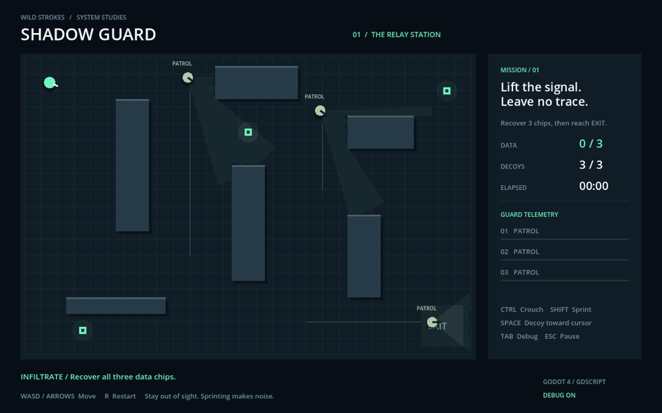

# Shadow Guard

A small playable stealth study built in **Godot 4 / GDScript**. Recover three data chips from a relay station and reach extraction while three guards patrol the floor.



Engine-rendered patrol preview; the player remains at spawn.

## Run

1. Download this folder (or the source ZIP).
2. Import `project.godot` into **Godot 4.4.1**.
3. Press **F6** with `scenes/main.tscn` open, or **F5** to run the project.

No plugins, asset downloads or paid dependencies. Desktop keyboard and mouse recommended. This is a native Godot project; it is not a browser export.

## Controls

| Input | Action |
|---|---|
| WASD / arrows | Move |
| Ctrl | Crouch: slower movement, reduced detection distance and buildup |
| Shift | Sprint: faster movement, periodic audible footsteps |
| Space | Throw a noise decoy toward the cursor (240 px max range) |
| Tab | Toggle path and AI state overlays |
| Escape | Pause / resume |
| R | Restart |

You have three decoys. Throws into walls, outside the station, or through cover are rejected without spending a charge. A guard already chasing you ignores decoys. Walls block vision. Sound intentionally travels through walls as a simple radial stimulus. A fully alerted guard must physically reach you to catch you; breaking line of sight lets you escape.

## Systems

- **Patrol → Investigate → Search → Patrol** for noise responses.
- **Patrol / Investigate / Search → Chase → Search** for confirmed sightings and lost targets.
- Gradual suspicion, a forward view cone and wall occlusion; crouching changes detection range and rate.
- Cached grid A* routing with periodic repathing; collision-aware axis movement.
- Last-known-position pursuit followed by a timed rotating search.
- A complete mission loop: pickups, locked extraction, failure, success, pause and reset.
- Procedural 2D rendering, wall-clipped cone visualization, animated noise rings and live guard telemetry.

[Download source ZIP](Shadow_Guard_Godot_Source.zip)

## Source layout

| File | Responsibility |
|---|---|
| `scripts/world.gd` | Obstacles, collision, line of sight and A* grid |
| `scripts/guard.gd` | Guard state machine, perception, memory and movement |
| `scripts/game.gd` | Mission, player input, UI and drawing |
| `tests/run.gd` | Headless behavior and mission regression checks |
| `tests/capture.gd` | Engine-rendered screenshot helper |

The simulation classes extend `RefCounted` and can be tested without a scene. `game.gd` owns presentation and orchestration. Edit patrol routes and chip positions in `reset()`; obstacles live in `world.gd`. Keep positions on walkable cells and rerun reachability checks after editing the level.

## Verification

Tested with Godot **4.4.1 stable**, Linux:

```sh
godot --headless --path . --editor --quit
godot --headless --path . --script res://tests/run.gd
godot --headless --path . --quit-after 180
```

Checks cover wall occlusion, path clearance, objective/patrol reachability, sight-to-chase, chase priority over sound, last-seen search, return to patrol, noise investigation, pickups, restart, extraction and capture. These are automated checks; desktop feel and difficulty still benefit from human playtesting.

## Scope

One handcrafted level with simple geometric art. No audio, animation assets, combat, networking or save system. The fixed map and cell size favor readable behavior over large-world scaling. Cone visuals are sampled rays; actual perception uses a direct line-of-sight test. Debug paths and labels toggle independently of gameplay cones and telemetry.

MIT licensed. Wild Strokes, 2026.
