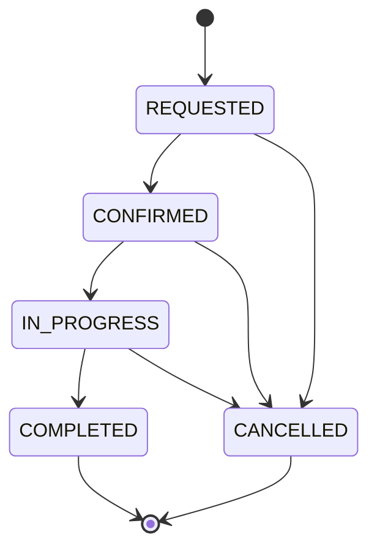

# Slotline

A small service business needs three things before work starts: a clear scope, an agreed price and a time to talk. Slotline puts those in one flow, with a Java backend and a separate admin workspace.

Built by **Owais / Wild Strokes**. This is a complete local portfolio application with a real database, not a static dashboard.

## What it does

- Builds a USD quote from a server-owned service catalogue, quantities, scope and optional extras.
- Shows the total, a 50% deposit and the exact remaining balance.
- Reserves a weekday kickoff call without allowing two bookings to take the same slot.
- Saves bookings in a persistent database.
- Gives each customer a private tracking link.
- Lets the admin search requests, review briefs, move bookings through their lifecycle and export CSV.
- Keeps a timestamped status history for each booking.

The catalogue and prices are illustrative portfolio data. No payments are collected and no emails are sent. The deposit is a proposed payment split, not a paid invoice.

## Run the download

Install **Java 17 or later**. The download bundle includes `release/slotline.jar`, so Maven is not needed just to try it.

**macOS / Linux**

```bash
export ADMIN_PASSWORD='Your-local-password-42'
./run.sh --app.demo-data=true
```

**Windows PowerShell**

```powershell
$env:ADMIN_PASSWORD = 'Your-local-password-42'
.\run.cmd --app.demo-data=true
```

Open:

- Customer booking page: <http://localhost:8080>
- Admin workspace: <http://localhost:8080/admin.html>
- Admin username: `admin`
- Admin password: the value you set above.

If you do not set `ADMIN_PASSWORD`, the app prints a random temporary password at startup. It changes on the next start. Configured passwords must be at least 12 characters.

`--app.demo-data=true` adds four clearly labelled fictional requests only when the database has no bookings. Omit it for an empty workspace. All demo emails end in `.example`.

The app binds to `127.0.0.1` by default. Stop it with Ctrl+C. Bookings remain in `data/slotline.mv.db`.

## Build from source

Use a **JDK 17+** rather than a JRE for development. The Maven Wrapper downloads Maven on its first run.

```bash
./mvnw clean verify
java -jar target/slotline-1.0.0.jar
```

On Windows use `mvnw.cmd clean verify`.

The packaged executable contains the backend and frontend. No Node installation, frontend build or separate database server is required.

## Try the full flow

1. Choose Website build and API integration. Keep Standard scope and Handover documentation, then enable Priority handover.
2. The quote should be **$543.75**, with a **$271.88** deposit and **$271.87** balance.
3. Choose a weekday kickoff, add a brief and submit.
4. Save the private tracking link from the confirmation screen.
5. Sign in to the admin workspace and open that request.
6. Change it to Confirmed. Refresh the customer tracking page to see the new event.
7. Export CSV, or cancel a test booking and confirm its slot becomes available again.

For a portfolio walkthrough, record this flow using fictional contact details. The admin pipeline card shows quoted open work, not collected revenue.

## Pricing rules

| Item | Rule |
| --- | --- |
| Website build | $240 per unit |
| Game UI implementation | $180 per unit |
| API integration | $160 per unit |
| Support sprint | $90 per unit |
| Quantity | 1–5 per selected service |
| Standard scope | Service prices × 1.00 |
| Advanced scope | Service prices × 1.50 |
| Handover documentation | $35, once per quote |
| Team walkthrough | $45, once per quote |
| Extra revision round | $25, once per quote |
| Priority handover | 25% of service subtotal plus extras |
| Deposit | 50% of total, rounded half up to two decimals |
| Balance | Total minus deposit |

All arithmetic uses `BigDecimal`. Quotes are valid for 24 hours, and the server recalculates prices from catalogue IDs. A request containing a client-supplied `total` or other unknown JSON property is rejected. There is no tax calculation in this version.

## Booking rules

- Kickoffs last 30 minutes. They are conversations, not delivery deadlines.
- Available starts: 09:30, 11:00, 14:00 and 16:00, Monday–Friday.
- The window is today through 30 days ahead, with at least two hours' notice.
- Default timezone: `Asia/Karachi`. The UI displays the configured timezone.
- A unique database slot key is the final authority on availability.
- Cancelling releases the slot, while preserving the booking and its history.
- One quote can create one booking. Retrying an identical request with the same idempotency key returns that booking, including its original tracking token.

## Admin lifecycle



Updates carry a version number. A stale admin tab receives a conflict instead of silently overwriting another update. Completed and cancelled bookings cannot be reopened.

## Code map

```text
src/main/java/com/wildstrokes/slotline/
  ApiController.java       HTTP routes and request validation
  ApiModels.java           Typed request and response records
  Catalog.java             Service and extra definitions
  QuoteService.java        Pricing and immutable quote snapshots
  BookingService.java      Reservations, tracking, lifecycle and CSV
  SecurityConfig.java      Admin sessions, passwords and CSRF
  DemoData.java            Optional fictional sample requests
src/main/resources/
  schema.sql               Database schema and unique constraints
  static/                  Customer, tracking and admin interfaces
src/test/java/             API, pricing, security and concurrency tests
```

## Stack

Java 17, Spring Boot 3.5.16, Spring Web, Spring JDBC, Spring Security, Bean Validation, H2, HTML/CSS and vanilla JavaScript. The frontend is served from the same application as the API. Fonts and visual assets are local/system resources; no third-party frontend CDN is required.

## Tests

```bash
./mvnw test
```

The automated suite exercises exact decimal pricing, advanced scope, invalid or tampered requests, CSRF, role checks, real session login, private tracking, repeat submissions, quote expiry, status versions, slot release, concurrent slot conflicts, admin filtering and spreadsheet-formula neutralisation in CSV.

GitHub Actions runs `verify` on pushes and pull requests.

## Configuration

| Environment variable | Default | Purpose |
| --- | --- | --- |
| `ADMIN_PASSWORD` | Random at startup | Admin password, minimum 12 characters |
| `PORT` | `8080` | HTTP port |
| `APP_HOST` | `127.0.0.1` | Bind address |
| `APP_ZONE` | `Asia/Karachi` | Booking timezone; keep it stable once bookings exist |
| `APP_DEMO_DATA` | `false` | Seed fictional requests into an empty database |
| `DATABASE_URL` | `jdbc:h2:file:./data/slotline;DB_CLOSE_ON_EXIT=FALSE` | H2 database location |
| `DATABASE_USER` | `sa` | Database user |
| `DATABASE_PASSWORD` | Empty | Local H2 database password |
| `SECURE_COOKIES` | `false` | Set `true` behind HTTPS |

## Scope and deployment notes

This version targets a single application instance with an embedded H2 database and one admin account. It includes session authentication, BCrypt password hashing, CSRF checks, private tracking tokens, escaped UI rendering, parameterised SQL, a restrictive content security policy and versioned status updates.

Before a public deployment, add HTTPS, login/public-request rate limits, account recovery, backups and operational monitoring. For multiple instances, replace the file database with a managed relational database and migrate the schema with a versioned migration tool. Add email/payment integrations only when there is a real provider and a defined workflow. The current sample does not perform payment collection or email delivery.

Tracking links grant access to the associated booking. They put the token in a URL fragment so it is not sent in the page request. Do not publish real tracking links, client details, database files or passwords in GitHub.

## Put it on GitHub

Create an empty repository named `slotline-java-booking`, then from this folder:

```bash
git init
git add .
git commit -m "Build Slotline booking and quote application"
git branch -M main
git remote add origin https://github.com/YOUR_USERNAME/slotline-java-booking.git
git push -u origin main
```

The included `.gitignore` excludes local databases, environment files, build outputs and the runnable release JAR. Publish the JAR as a GitHub Release asset if you want visitors to try it without building. GitHub Pages can serve static files but cannot run this Java backend.

Suggested repository description:

> Java service-booking app with server-calculated quotes, kickoff scheduling, private tracking, an admin dashboard and concurrency-safe reservations.

Suggested topics: `java`, `spring-boot`, `booking-system`, `rest-api`, `spring-security`, `jdbc`, `portfolio`.

## License

MIT. See [LICENSE](LICENSE).
