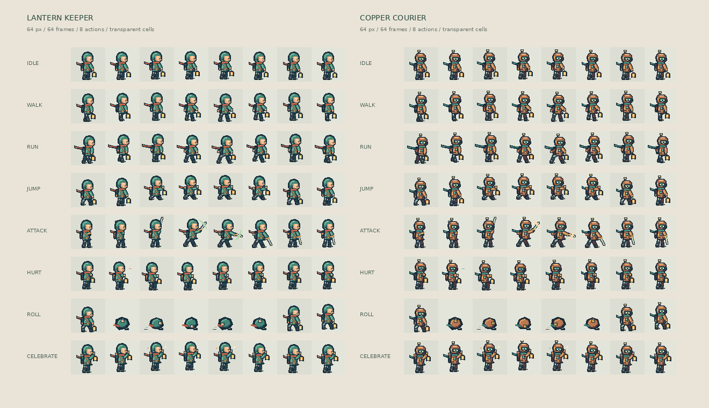
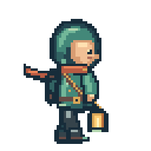
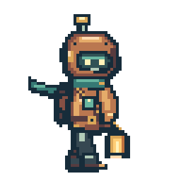

# Flipbook · Sprite animation workbench

A browser tool by Wild Strokes for checking sprite sheets before putting them into a game. Pick an animation row, tune its pace, inspect individual frames and export the clip as a transparent GIF.

**[Open Flipbook](https://strokeswild08.github.io/sprite-preview/)** · **[All live projects](https://strokeswild08.github.io/projects/)**

## Character sheets



| Character | Complete pack | Original sheet | Animation data |
| --- | --- | --- | --- |
| Lantern keeper | [Download ZIP](assets/keeper-character-pack.zip) | [Transparent PNG](assets/keeper-sheet.png) | [JSON atlas](assets/keeper-atlas.json) |
| Copper courier | [Download ZIP](assets/courier-character-pack.zip) | [Transparent PNG](assets/courier-sheet.png) | [JSON atlas](assets/courier-atlas.json) |

 

Each sheet is **768 × 768 px**, arranged as eight columns and eight rows of **96 × 96 px** cells. There is no padding. Both characters face right; mirror the sprite to face left. The ground pivot is `(48, 88)` within each cell. The proportions follow a travelling RPG hero: smaller head, longer legs, a layered cloak, leather bracers, belt pouches and metal trims. Walk/run use grounded contact and passing poses. The attack has anticipation, a lunge, a blade arc and recovery. All artwork uses integer pixels, without smoothed edges.

| Row | Action | FPS | Playback |
| --- | --- | --- | --- |
| 1 | Idle | 8 | Loop |
| 2 | Walk | 10 | Loop |
| 3 | Run | 14 | Loop |
| 4 | Jump | 10 | Once |
| 5 | Attack | 12 | Once |
| 6 | Hurt | 10 | Once |
| 7 | Roll | 12 | Once |
| 8 | Celebrate | 9 | Loop |

The JSON gives the source rectangle and duration for every frame, plus the loop flag and pivot. PNG is the game asset; the 4× GIFs are presentation previews. These are side-view animation sets, with one facing direction.

## Features

- Two complete 96 × 96 character sheets: Lantern keeper and Copper courier. Each has 64 frames across eight actions.
- Idle, walk, run, jump, attack, hurt, roll and celebrate, with named action buttons and individual playback rates.
- Complete downloadable character packs: transparent PNG sheet, animation JSON and eight action GIF previews.
- One-shot playback for jump, attack, hurt and roll; looping idle, walk, run and celebrate.
- Local static PNG / WebP import, file chooser or drag-and-drop.
- Frame width / height, row and first / last frame controls.
- Play once, forward, reverse and ping-pong loops; 1–60 FPS; play/pause and frame stepping.
- A forest-ruins stage aligned to the feet, plus transparency checker, paper / ink backdrops, onion skin and pixel grid. The stage stays out of asset exports.
- Click the sheet to inspect a frame; use the scrubber to step through the active clip.
- Transparent current-frame PNG, looping clip GIF and full-sheet PNG export.
- GIF encoding in a module worker, keeping preview controls responsive.
- Keyboard controls and reduced-motion support.

Your sheet stays in the browser. No upload, backend, analytics, account or CDN is used. The app does not save sheets between visits.

## Use your own art

Open a **static PNG or WebP**, then enter the dimensions of one frame. Frames must have a uniform size and no margin or padding between cells. Sheets are read left to right, row by row; one row is one clip. Any leftover pixels at the right / bottom are excluded, with a status message.

Import limits: 10 MB, 4,096 × 4,096 image dimensions, 4,096 grid cells, 2,048 × 2,048 per frame. The initial frame size is a provisional 32 px (larger for exceptionally large grids); set it to match your sheet.

Each clip can select up to 120 frames. GIF export allows up to 512 × 512 per output frame and eight million output pixels in total. Lower the export scale or shorten the clip if you reach that limit. PNG frames support up to 2,048 × 2,048 output pixels.

GIF preserves an exact palette when the clip has at most 255 opaque colors; more colorful clips are quantized to fit the format's 256-color limit. Alpha below 128 becomes transparent, alpha at or above 128 becomes opaque. GIF timing uses 10 ms units; high FPS is limited to a 20 ms frame duration for broad player compatibility. Use PNG for full alpha and color precision. Guides, backdrops and onion skin are never baked into exports.

## Rebuild the character assets

The committed PNGs, JSON, GIFs and ZIPs can be regenerated from the editable character source. A recent Node.js, Python 3 and the canvas development dependency are needed:

```sh
npm install
npm run build:art
```

`demos.js` owns the artwork and action poses; `scene.js` draws the preview-only forest. `scripts/build-assets.mjs` rebuilds the sheets and all preview GIFs; `scripts/build-packs.py` packages each character. The browser app itself still runs without installation.

## Run locally

No installation or build step is needed to run the browser app. Use a local HTTP server so ES modules and the export worker can load:

```sh
cd sprite-preview
python3 -m http.server 8000
```

Open `http://localhost:8000`. Do not launch the HTML directly using `file://`.

Tests run on a recent Node.js version, without npm dependencies:

```sh
npm test
```

## Controls

| Action | Control |
| --- | --- |
| Play / pause | Play button or Space with the preview focused |
| Previous / next frame | Arrow buttons or left / right arrow keys |
| Choose an individual frame | Click the sheet, or move the scrubber |
| Change the clip | Animation row and first / last frame inputs |
| Save the current pose | Frame PNG |
| Save the animation | Clip GIF |

## Code map

| File | Responsibility |
| --- | --- |
| `index.html` | The workbench controls and labels |
| `style.css` | Responsive layout and visual styling |
| `app.js` | File decoding, Canvas rendering, input, playback and downloads |
| `core.js` | Frame math, clip sequences, timing and size limits |
| `demos.js` | Integer-pixel character artwork, action poses and atlas metadata |
| `scene.js` | Preview-only forest ruins, with ground aligned to the sprite |
| `scripts/` | Reproducible artwork, atlas, GIF and ZIP generation |
| `gif.js` | Exact pixel-art palettes and GIF encoding |
| `export-worker.js` | Runs GIF encoding outside the main UI thread |
| `tests/core.test.js` | Clip ordering, timing, limits and GIF structure checks |
| `vendor/gifenc.js` | gifenc 1.0.3, bundled locally; license in `vendor/LICENSE.md` |

Project code and demo art are published for inspection; no project-wide reuse license has been assigned. The bundled GIF encoder is third-party MIT-licensed code.

## How sprite-sheet playback works

A sprite sheet stores animation frames in a regular grid. These character sheets are 768 × 768 pixels, with 96 × 96 cells: eight columns and eight action rows, or 64 frames.

`core.js` converts a frame number to its source rectangle. `app.js` draws that rectangle on the Canvas. At 10 FPS the next frame appears every 0.1 seconds. Reverse playback reverses the sequence; ping-pong runs forward and then back.

Download a complete character pack for its transparent PNG, JSON frame data and action GIF previews. Use PNG and JSON in your game. The action buttons preview movement and other poses; jump, attack, hurt and roll play once, and can be replayed with Play.

`demos.js` generates each pose from integer-pixel polygons and limb positions. `gif.js` builds the palette and encodes the selected frames in an export worker. A PNG export saves the current pose; a GIF export saves the selected animation clip.
