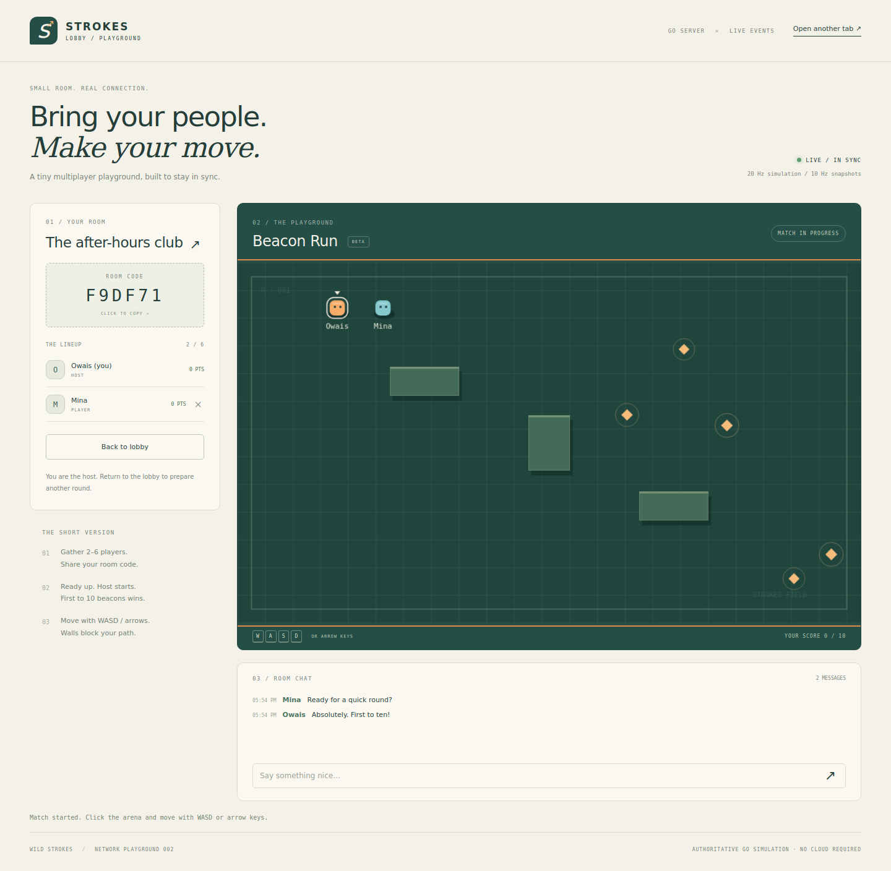
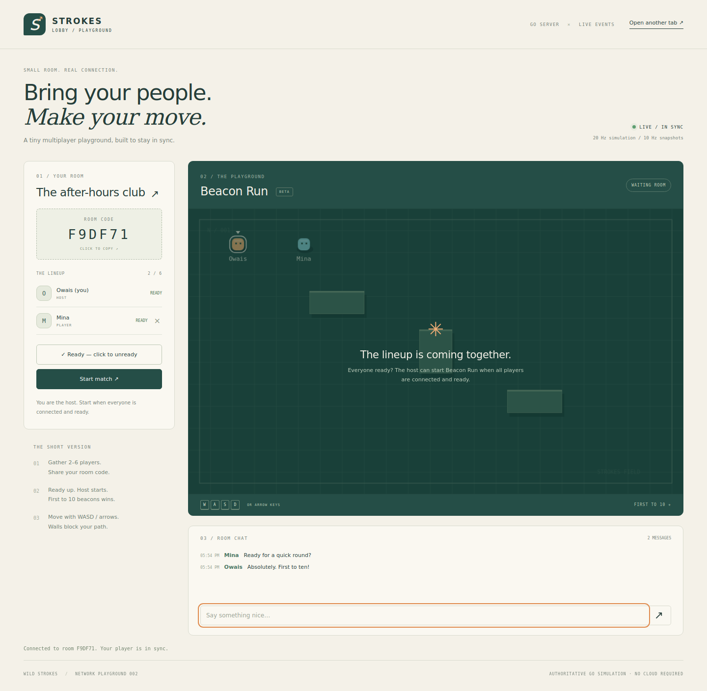

# Strokes Lobby

**A Go multiplayer lobby with a playable browser arena.** Create a room, share its code, ready up and race for beacons. Two independent browser tabs show the same server-owned match.



## Run locally

Install **Go 1.24 or newer**, open this folder in a terminal and run:

```sh
go run .
```

Open **http://127.0.0.1:8989**.

1. Enter your name and create a room.
2. Click **Open another tab**. Enter another name, choose **Join room** and use the six-character room code.
3. Ready the second player. The host starts once everyone is connected and ready.
4. Click the arena and move with **WASD or arrow keys**. Touch buttons are available on narrow screens.
5. Collect ten beacons to win. The host can return the room to the lobby for another round.

Use the app's new-tab link or an independent tab, rather than duplicating an existing player tab. Session storage belongs to each tab; a browser's Duplicate Tab feature may copy the same player session.

```sh
# Use a different port
go run . -port 9090

# Build an executable; use strokes-lobby.exe on Windows
go build -o strokes-lobby .
```

The interface is embedded in the executable. There are no third-party Go modules, JavaScript frameworks, API keys or database setup steps.

## Included

- Six-character room codes; up to six players per room and 32 active rooms.
- Named players, visible connected/ready states and a live roster.
- Host-only start, remove-player and return-to-lobby controls.
- Automatic host transfer when the current host leaves or expires.
- Live chat with a bounded 60-message history.
- Session resume after refresh or a brief stream interruption, with a 15-second disconnected-player reservation.
- Server-owned 20 Hz movement, wall collisions, beacon placement, scores and victory state.
- Ten snapshots per second with browser interpolation and input sampling.
- Keyboard and touch controls, room code copying and a responsive interface.



## How synchronization works

The browser sends authenticated JSON actions with HTTP POST. A fetch-based Server-Sent Events stream carries full room snapshots back to each player. This uses SSE rather than WebSockets. The fetch stream keeps the session token in an Authorization header instead of a URL.

The Go hub owns the room state under a mutex. Clients send movement directions, never positions or scores. The server normalizes direction vectors, caps movement speed and stops stale input after 350 ms. Players can overlap; walls block movement. The first server-processed pickup reaching ten wins.

Each player has a one-slot stream queue: newer snapshots replace stale queued snapshots, so a slow receiver cannot build an unbounded backlog. Stream generations prevent an old disconnected request from marking its replacement offline. A disconnected player stops moving and is removed after 15 seconds. Empty rooms are deleted. Rooms and chat are in memory and disappear when the server stops.

This is a **local networking prototype**, bound to `127.0.0.1`. The included version does not expose an internet or LAN server. It has no accounts, persistent storage, matchmaking service, TLS deployment or distributed room state. GitHub Pages cannot execute the Go backend; run the project locally. For the local demonstration, two tabs are recommended; many simultaneous SSE tabs can hit a browser's HTTP/1.1 connection limit.

## API

| Endpoint | Request / response |
| --- | --- |
| `POST /api/create` | `{ "name": "Owais", "title": "Night crew" }` → session |
| `POST /api/join` | `{ "name": "Mina", "code": "A1B2C3" }` → session |
| `POST /api/action` | Bearer session; `ready`, `chat`, `start`, `reset`, `kick`, `leave`, `move` |
| `GET /api/events` | Bearer session; SSE stream of complete room snapshots |

A session contains `token`, `playerId` and `code`. Snapshots contain public player details, chat, obstacles, beacons and phase, with no private tokens. Actions are limited to 40 per player per second. Create/join admission is limited to 12 attempts per second across the local server. JSON bodies are limited to 2 KiB; display names to 20 characters, room names to 32 and messages to 160.

## Verify

```sh
go test -race -cover ./...
go vet ./...
```

Tests cover room permissions, ready gating, scoring, collision, speed limits, stale input, reconnect epochs, expiration, host migration, capacity, chat bounds, token privacy, concurrent operations and actual HTTP/SSE requests. See [validation notes](docs/VALIDATION.md) for browser checks and measured coverage.

## Source map

| File | Responsibility |
| --- | --- |
| `internal/lobby/hub.go` | Room/session lifecycle, broadcast queues, authoritative game simulation |
| `main.go` | JSON routes, SSE streaming, origin/Host guards, embedded UI and server lifecycle |
| `web/app.js` | Tab session, reconnection, controls, DOM interface and interpolated canvas renderer |
| `web/style.css` | Responsive cream/forest interface |
| `*_test.go` | Engine and HTTP integration tests |

References: [Go HTTP server](https://pkg.go.dev/net/http) · [SSE event format](https://developer.mozilla.org/en-US/docs/Web/API/Server-sent_events/Using_server-sent_events)

MIT licensed · Wild Strokes
