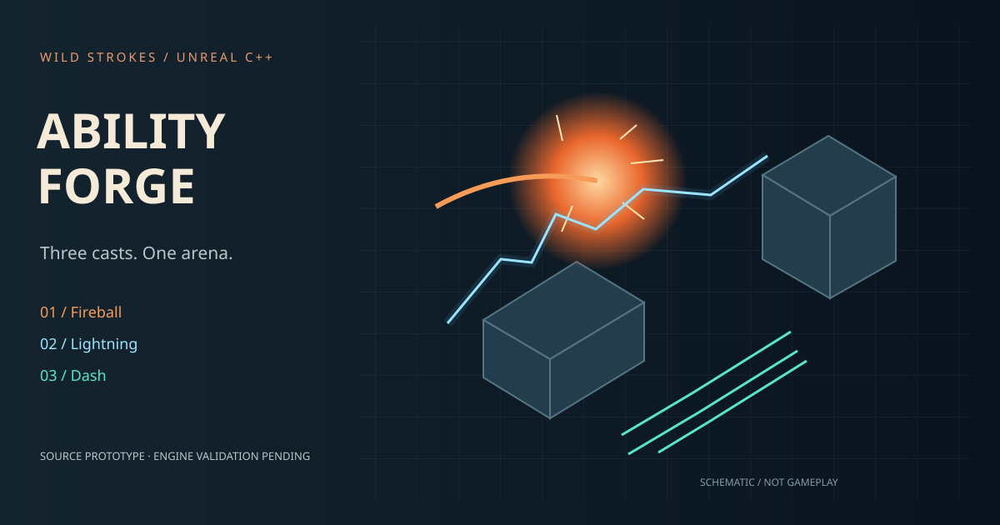

# Ability Forge — Unreal C++ Ability & Impact System

A single-player **Unreal Engine 5.5 source prototype** by Owais / Wild Strokes: fireball, lightning, swept dash, cooldown HUD, damageable material targets and Niagara integration slots.

**[Project page](https://strokeswild08.github.io/unreal-ability-forge/)** · **[Download source](https://strokeswild08.github.io/unreal-ability-forge/ability-forge-source.zip)**

> Delivery status: C++ source project, not a compiled Unreal release or finished Niagara pack. Unreal Editor is unavailable in the authoring environment. Unreal compilation, editor setup, gameplay, packaging and Niagara assets remain unverified. No `.uasset`, `.umap`, executable or Unreal gameplay footage is bundled. The setup script creates starter material assets and a blank map when run in a local editor; it does not create Niagara systems.



## What the source implements

| System | Intended behavior |
| --- | --- |
| Fireball | Collision sphere + projectile movement, 1600 cm/s, 3-second lifetime; impact burst and 260 cm radial target damage with wall occlusion |
| Lightning | Camera-assisted aim, muzzle trace up to 1600 cm, 45 target damage, short segmented mesh beam and surface impact |
| Dash | Up to 600 cm of additional swept movement over 0.22 seconds; stops on a blocking hit; no invulnerability |
| Cooldowns | Independent 0.8s / 2.5s / 1.6s fireball/lightning/dash timers using game time |
| HUD | Crosshair, ability availability, cooldown progress, controls and feedback |
| Targets | Six 100 HP targets: two each of metal, stone and glass; three-second automatic reset after destruction |
| Arena | Runtime floor, four boundaries, two cover pieces and point lights; no external environment assets |
| Effects | Primitive mesh bursts and optional Niagara systems, with bounded concurrent counts and teardown cleanup |

The source uses built-in engine cubes/spheres as prototype geometry. A supplied Python editor setup creates two simple material assets with a `Color` parameter and an empty map. The game mode creates the actual arena at play time. Mesh effects are prototypes, not authored Niagara particles or finished production art.

## Open in Unreal

1. Install **Unreal Engine 5.5** and its supported C++ toolchain. On Windows, follow Epic's [Visual Studio setup guide](https://dev.epicgames.com/documentation/en-us/unreal-engine/setting-up-visual-studio-development-environment-for-cplusplus-projects-in-unreal-engine?application_version=5.5).
2. Extract the source ZIP. Generate project files for `AbilityForge.uproject`; build **AbilityForgeEditor / Development Editor**. Included Windows/Linux helper scripts use `FORGE_UE_ROOT` for the engine directory. Engine compatibility has not been compiled here.
3. Open `AbilityForge.uproject`. Save any currently dirty map. In **Tools → Execute Python Script**, run `Tools/setup_editor.py` to author the missing starter materials and map. Existing assets at those names are preserved.
4. Open `/Game/Maps/AbilityArena`. Choose **Play → Spawn Player At → Default Player Start**, set **one player / Standalone**, then Play. Global default game mode is `ForgeGameMode`.
5. Click in the viewport. Move with WASD, aim with the mouse. LMB casts fireball, RMB lightning, Left Shift dash, and R resets target health/effects/cooldowns. Fireball is a press action, not automatic held fire.

The engine Entry map is the initial fallback until setup creates AbilityArena. If you start in a custom map, verify its world settings have no conflicting game-mode override. Set AbilityArena as Editor Startup Map and Game Default Map after the local map is created. This project uses legacy InputComponent bindings explicitly; Enhanced Input is not required.

## Damage and collisions

Fireball damage falls from 60 at the blast center to 15 at the 260 cm edge. Only `ForgeTarget` actors receive damage in this training sample; there is no player health or friendly fire. Visibility traces reject occluded blast targets. A fireball that expires without hitting does not explode. Both offensive abilities reject casts when the short path to their muzzle is blocked; failed spawns do not consume cooldown.

Lightning is an instant trace, not a chain lightning implementation. A miss consumes its cooldown. Dash uses the last movement input, or forward if no input exists; capsule sweeps stop it at obstacles. Gravity remains managed by CharacterMovement, so actual world displacement also depends on collision and falling. No jump, dodge immunity, stamina or multiplayer prediction is included.

Surface IDs are configured in `DefaultEngine.ini`: 1 = Metal, 2 = Stone, 3 = Glass. Targets set physical material overrides; lightning requests physical material hit data. Target class IDs also provide reliable demo routing; other missing/unrecognized surfaces fall back to stone.

## Source architecture

- `ForgeAbilityComponent`: cast acceptance, independent cooldowns, aiming, dash and effect routing; Blueprint callable.
- `ForgeProjectile`: collision-driven impact and occlusion-aware radial damage.
- `ForgeEffectsComponent`: optional Niagara slot lookup, parameter binding, primitive fallback and effect lifecycle.
- `ForgeBurst` / `ForgeBeam`: transient primitive prototype visuals.
- `ForgeTarget`: health, material identity and timed restoration.
- `ForgeCharacter`: camera, movement and input.
- `ForgeHUD`: Canvas ability HUD.
- `ForgeGameMode`: runtime arena assembly and player-start fallback.
- `ForgeRules.h`: engine-independent policies used by the actual ability/projectile code.
- `ForgeVisuals.h`: material tint helper for editor-generated starter assets.

See [Niagara authoring](docs/NIAGARA.md) for parameter contracts and effect recipes, and [engine acceptance](docs/ENGINE_ACCEPTANCE.md) for the remaining concrete build/play checks. This is a small component-based sample, not Unreal's Gameplay Ability System (GAS).

## Verified locally

Portable policies compiled with `g++ -std=c++17 -Wall -Wextra -Werror -pedantic` and passed **2292 assertions**, including 1000 cooldown schedules, radial damage monotonicity and dash timing at 30/60/144 Hz. These are policy tests only: they do not exercise Unreal collision or compile any Unreal module. Python setup syntax and source manifest checks pass; editor API execution is pending.

```sh
g++ -std=c++17 -Wall -Wextra -Werror -pedantic tests/rules_test.cpp -o forge-rules-test
./forge-rules-test
python3 tests/project_check.py
```

The GitHub workflow runs these portable checks on hosted Linux. It does not install or build Unreal. No engine-tested status, packaging compatibility, frame-rate target or authentic gameplay recording is claimed.

## Reuse and scope

Single-player standalone only; the component rejects other net modes. No sound, controller/mobile support, networking, save system, enemy AI, external textures or third-party assets. Maximum 16 owned projectiles, 32 Niagara effects and 24 primitive bursts per component. Assigned Niagara systems must be finite; otherwise they can occupy the effect budget until reset/end play. The primitive beam is always shown even when a custom Lightning Niagara system is assigned; remove that fallback if your authored system renders the full beam.

Original project source, scripts and schematic artwork are MIT licensed. Unreal Engine and engine content remain under Epic's own terms; no engine assets or engine code are redistributed in this archive.
